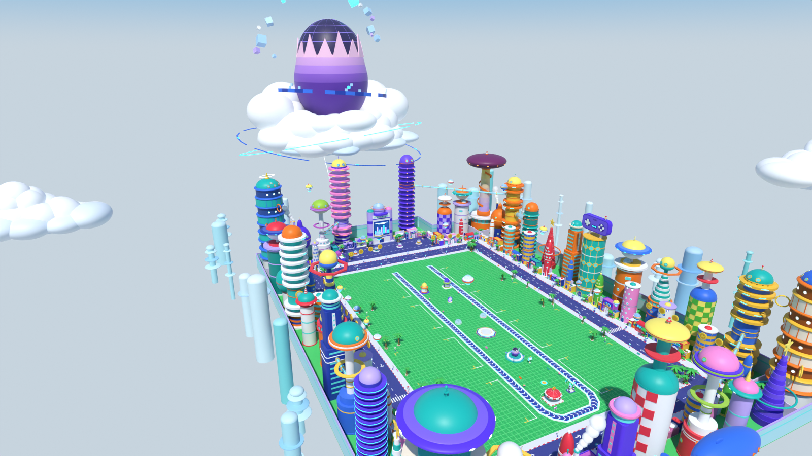

# Carte « île du futur » : ville-jouet rétro-futuriste en studs, pour un jeu Roblox à parcelles et tapis roulant

Carte complète d'un **nouveau jeu** (pas une zone du couloir « Volez un œuf ») : un jeu « Steal a … » avec 8 parcelles
de joueurs et un tapis roulant au centre. La **forme et la taille** sont celles du jeu des deux captures envoyées
(pelouse, trottoirs, route, tapis en U, stand, machine, sanctuaire, podium, parcelles, couronne de bâtiments) ; seul
l'habillage change. La ville nocturne de gratte-ciel devient une **île scientifique rétro-futuriste en plein midi
tropical** : tours rondes couleur bonbon, dômes à hublots, cônes rayés, soucoupes, anneaux, tubes de verre, palmiers,
sol vert quadrillé. Au bout de l'axe du tapis, un **œuf-laboratoire géant à la coquille brisée** est posé sur un
cumulus et domine le ciel. **Tout le sol est en studs.** Les **8 parcelles restent vides** : vous y construirez les
bases ; des repères invisibles les marquent.

`CarteEgghead` n'est qu'un nom de fichier interne, jamais affiché aux joueurs (voir plus bas : le renommer avant de
publier).



| Vue | Fichier |
|---|---|
| Vue d'ensemble depuis le côté du soleil, l'œuf au fond | [`rendus/aerienne.png`](rendus/aerienne.png) |
| Vue aérienne depuis le sud-est | [`rendus/aerienne_sud.png`](rendus/aerienne_sud.png) |
| Plan de la carte vu de dessus (le nord en haut) | [`rendus/plan_carte.png`](rendus/plan_carte.png) |
| Tout le modèle vu de dessus, ciel compris (œuf, cumulus, dirigeable) | [`rendus/plan.png`](rendus/plan.png) |
| Même caméra que vos deux captures | [`rendus/capture1.png`](rendus/capture1.png), [`rendus/capture2.png`](rendus/capture2.png) |
| Comparaison avec vos captures (référence à gauche, carte à droite) | envoyée à part, pas dans le dépôt : il est public, et vos captures montrent l'interface d'un autre jeu et des pseudos de joueurs |
| Ce que voit le joueur à l'apparition (caméra Roblox par défaut) | [`rendus/joueur.png`](rendus/joueur.png) |
| L'œuf sur son nuage au-dessus de la couronne nord, vu de la pelouse | [`rendus/ciel.png`](rendus/ciel.png) |
| L'œuf-laboratoire de près | [`rendus/oeuf.png`](rendus/oeuf.png) |
| Pièces du centre : stand de vente, machine, monument, podium | [`rendus/centre.png`](rendus/centre.png) |
| Pendant de la capture 1, vers le sud | [`rendus/nord.png`](rendus/nord.png) |
| Esplanade nord : front du laboratoire à écran, port de nacelles | [`rendus/esplanade.png`](rendus/esplanade.png) |
| La route est vue de la chaussée : trottoirs, front de rue, l'œuf au fond | [`rendus/rue.png`](rendus/rue.png) |
| Repère d'angle nord-est (champignon géant à ruban) et son tube de verre | [`rendus/coin.png`](rendus/coin.png) |

Les rendus sont en plein soleil, comme la place de démonstration (Blender rend le Neon sans halo : dans Roblox, le
`BloomEffect` de la place le fait rayonner). Comparés à vos captures, le tapis, le stand, la machine, les bords de la
pelouse, les trottoirs, la route et la ligne des façades tombent aux mêmes endroits ; les
bases des joueurs (dalles grises, pilier orange) et l'interface n'existent que dans la référence : ici, les
parcelles sont vides et attendent vos bases.

## Ce qu'il y a dans la carte

1. **Le sol** (groupes `Sol`, `Trottoirs`, `Routes`) : pelouse vert vif à studs, parcourue d'une **grille de lignes
   claires** en relief (1 stud de large, tous les 8) ; trottoirs en pavé lavande très pâle, 0,4 plus haut, bordés
   côté route d'une **bordure rayée rouge et blanc** ; route indigo de deux voies, tirets blancs au milieu, flèches
   par paires, deux passages piétons (route est et route ouest) ; sol vert clair sous la couronne.
2. **Le tapis roulant** (`Tapis`) : un U ouvert vers le nord, comme dans la référence. Bande bleu nuit à studs en
   léger creux, **chevrons blancs** tous les 8 dans le sens du flux, bordures blanches à fin liseré Neon cyan,
   embouts carrés aux deux têtes nord (rien de haut au-dessus : la caméra ne saute pas). Flux : on descend la voie
   ouest vers le sud, on fait demi-tour d'ouest en est, on remonte la voie est. Chaque pièce de la bande porte les
   attributs `Troncon`, `FluxX` et `FluxZ` (sens du flux) pour scripter le défilement, par exemple
   `part.AssemblyLinearVelocity = Vector3.new(part:GetAttribute("FluxX"), 0, part:GetAttribute("FluxZ")) * vitesse`.
3. **Le centre, dans le U** (`Centre`, un sous-modèle par pièce), du sud au nord :
   - **stand de vente** (à la place du stand « VENDRE ») : kiosque rond à dôme rouge à méridiens blancs, lambrequin
     rayé rouge et blanc, pièce d'or géante, sur un socle 28 × 24 ; devant lui, au nord, la **zone de vente**
     tracée en pointillés au sol (demi-disque de rayon 20) ;
   - **machine** (à la place de la machine à deux piliers) : deux pylônes rayés à boules Neon, bulle de verre à
     cœur violet, anneau d'or ;
   - **plaque d'apparition** dorée (repère `Spawn`) ;
   - **monument de l'œuf** (à la place du sanctuaire des quêtes) : plateau de disques turquoise, petite réplique
     de l'œuf fêlé, anneau de données, petits cubes ; à côté, le **panneau holographique des quêtes**, sans texte ;
   - **podium octogonal** Ø 38 à anneau lumineux, dont le **centre (Ø 20) reste libre** pour la statue « meilleure
     unité du serveur » de votre jeu ;
   - au nord : **portail violet** (anneau ouvert à voile Neon que l'on traverse), **deux kiosques à dôme** contre les
     voies, deux coupoles miniatures, bancs.
4. **La couronne de bâtiments** (`Tours`, 172 emplacements), tout autour de la route :
   - **front de rue continu** : boutiques à arche, kiosques, tours à hublots et fusées (jusqu'à 94 de haut), reliés
     par des bâtiments bas ; des murs pleins ferment le fond de chaque baie ;
   - derrière, **33 tours** de l'île de 115 à 245 de haut : galettes empilées, champignons, soucoupes, têtes-boules,
     bulbes à cheminée, damiers, bourrelets, tours à gradins, tour à anneau, cônes rayés à étoile, tour à enseigne
     en forme de manette ; une famille de couleurs par côté ;
   - aux quatre angles, les plus hautes (230 à 250) : champignon géant à ruban (NE), deux tours en pneus (NO, SE),
     tour-soucoupe (SO) ;
   - **6 tubes de verre** à anneaux jaunes ou dorés entre des tours, de 70 à 150 de haut, dont un ondulé ;
   - un mur de fond continu et, au-delà, une **skyline lointaine** pâle (36 tours simples, sans collision) qui
     remplit les interstices vue de la pelouse ; vue d'en haut (rendus aériens, Studio), ce sont les colonnes pâles
     posées hors de l'île : groupe `Ciel/Skyline`, supprimable ;
   - une **barrière invisible** (`Tours/Limites`, 8 blocs, de 0,4 à 40 de haut) sur la ligne des façades : on ne
     passe pas dans les coulisses de la couronne.
5. **L'esplanade nord** : un renfoncement de la couronne au bout de l'axe, avec le **front du laboratoire** (118 de
   haut, grand écran abstrait Neon tourné vers le sud, sans texte : la version île du bâtiment à écran géant de la
   référence), un **port de nacelles** (4 aires rondes à nacelle garée) et des palmiers.
6. **Le ciel** (`Ciel`) : l'**œuf-laboratoire** (coquille rose et lavande qui fonce vers le violet, cassure en
   zigzag, intérieur sombre à grille lumineuse) sur un grand **cumulus**, au-delà de la couronne nord en
   (0 ; -900), entre y ≈ 200 (dessous du nuage) et y ≈ 610 (haut de la coquille), entouré d'un arc de cubes de
   données et relié au sol par un câble ; 17 **nacelles** en lévitation (chacune avec son faisceau), des lignes de
   **pièces d'or** géantes, un **dirigeable en forme de baleine**, 3 cumulus lointains. Tout est à 55 studs ou plus
   au-dessus des zones où l'on marche. Rien de ce qui vole ne projette d'ombre (`CastShadow = false`) : pas de
   taches sombres sur la pelouse ni sur les parcelles.
7. **Le mobilier** (`Mobilier`) : palmiers à cocos en jardinières rondes rayées, lampadaires à écran (trottoir
   intérieur) et lampadaires-soucoupes (trottoir extérieur), jardinières à haie contre les façades, bancs,
   poubelles, feux tricolores et potelets aux passages piétons, rambardes blanches à boules, panneaux à
   pictogrammes, champignons lumineux.

## Dimensions (studs)

| Élément | Valeur | Réglage dans `plan.py` |
|---|---|---|
| Emprise au sol (couronne comprise) | **702 × 1 019** : x -351 → 351, z -572 (fond de l'esplanade) → 447 | `COURONNE_*`, `FOND_Z` |
| Pelouse | **410 × 637** : \|x\| ≤ 205, z -336 → 301 ; grille d'1 stud au pas de 8 | `PELOUSE_X`, `PELOUSE_Z_SUD`, `PELOUSE_Z_NORD`, `GRILLE_PAS` |
| Trottoir intérieur | **12** (\|x\| 205 → 217 ; z 301 → 313 et -336 → -348), dessus à 0,4 | `TROTTOIR_INT_*` |
| Route | **36**, deux voies de 18 (\|x\| 217 → 253 ; z 313 → 349 et -348 → -384) | `ROUTE_*` |
| Trottoir extérieur | **18** (\|x\| 253 → 271 ; z 349 → 367 et -384 → -402), dessus à 0,4 | `TROTTOIR_EXT_*` |
| Couronne | façades en \|x\| = 271, z = 367 (sud) et z = -402 (nord) ; 80 de profondeur | `ALIGNEMENT_*`, `COURONNE_PROFONDEUR` |
| Esplanade nord | \|x\| < 140, z -402 → -490 | `ESPLANADE_X`, `ESPLANADE_Z` |
| Tapis | bande de **16** (bordure 3 + tapis 10 + bordure 3) ; voies en x = ±48,5 ; têtes en z = -294 ; demi-tour de z 258,5 à 294,3 ; dessus de la bande 0,6, des bordures 1,0 | `TAPIS_*` |
| Parcelles (8, vides) | **110 (x) × 102 (z)** chacune, \|x\| 81 → 191 (centres x = ±136), rangées z = 216, 72, -72, -216 (pas de 144, écart de 42) | `PARCELLE_*`, `RANGEES_Z` |
| Bandes d'entrée des parcelles | **16 × 102** côté tapis, \|x\| 65 → 81 | `ESCALIER_X_EXT` |
| Allées libres | \|x\| 56,5 → 81, entre le tapis et les parcelles | `COULOIRS_MARCHE` |
| Hauteurs | front de rue 14 → 94 ; tours 115 → 245 ; angles 230 → 250 ; front du laboratoire 118 ; œuf de y ≈ 200 à 610 | `CEINTURE`, `OEUF` |
| Pièces | **13 565**, dont 835 Neon, 46 en verre, 72 transparentes (plafonds 24 000 / 1 500 / 400) | `python carte.py --stats` |

L'**origine** du modèle (son pivot) est le **centre de jeu, au niveau du sol** : milieu du tapis et du bloc des
8 parcelles, y = 0 sur le dessus de la pelouse. +X = est (droite de la capture 1), +Z = sud (vers la caméra de la
capture 1), nord = -Z. Comme dans la référence, la pelouse va 35 studs plus loin au nord qu'au sud.

## Les parcelles (vides) et les repères

Les 8 parcelles et leurs bandes d'entrée ne contiennent **que la pelouse** : rien d'autre entre y 0,3 et 80
(vérifié), et rien de solide dans les allées entre le tapis et les parcelles. Le groupe facultatif
`TracesParcelles` (équerres dorées aux coins, bord blanc de la bande d'entrée, au ras du sol) aide à les voir :
supprimez-le quand vos bases sont posées.

Le dossier `CarteEgghead.Reperes` contient 41 repères invisibles (transparence 1, sans collision, détectables par
`Touched` et les raycasts). Les repères de zone (parcelles, entrées, zone de vente, têtes du tapis) ont 8 de haut,
le bas au sol (sur la bande pour les têtes du tapis) ; les autres ont 1 de haut.

| Repère | Où (x ; z) | À quoi il sert |
|---|---|---|
| `Spawn` | (0 ; 205), 8 × 8, regard vers le nord | apparition générale (le `SpawnLocation` de la place de démo y est posé) |
| `Parcelle_W1` … `Parcelle_W4`, `Parcelle_E1` … `Parcelle_E4` | emprises complètes 110 × 102 ; W = ouest, E = est, rangée 1 = sud | poser une base ; l'**avant** du repère (`LookVector`) **regarde le tapis** (E : yaw 90, W : yaw 270) |
| `Entree_W1` … `Entree_E4` | bandes 16 × 102 entre la parcelle et l'allée (\|x\| 65 → 81) | rampe, escalier ou porte de la base ; détecter qu'un joueur entre |
| `Apparition_W1` … `Apparition_E4` | (±62 ; rangée), regard vers la parcelle | faire réapparaître un joueur devant sa base |
| `Tapis_Debut` | tête ouest (-48,5 ; -290), regard vers le sud | là où les objets apparaissent sur le tapis |
| `Tapis_01` … `Tapis_08` | sommets de l'axe du tapis **dans le sens du flux**, posés sur la bande (y 0,6) : 01 (-48,5 ; -294) tête ouest → 02 (-48,5 ; 258,5) → 03 (-40,5 ; 276,3) → 04 (-28,75 ; 286,3) → 05 (28,75 ; 286,3) → 06 (40,5 ; 276,3) → 07 (48,5 ; 258,5) → 08 (48,5 ; -294) tête est | trajet des objets, de point en point |
| `Tapis_Fin` | tête est (48,5 ; -290), regard vers le nord | là où les objets disparaissent |
| `Vente` | stand de vente (-16,5 ; 244,5), 28 × 24 | PNJ ou `ProximityPrompt` de vente |
| `ZoneVente` | demi-disque de rayon 20 centré en (-15 ; 245), ouvert vers le nord : boîte 40 × 20 | savoir si un joueur est dans la zone de vente |
| `Machine` | (25 ; 240), 12 × 10 | la machine du jeu |
| `Monument` | (0 ; 126), 34 × 36 | PNJ des quêtes (le sanctuaire de la référence) |
| `Quetes` | (14 ; 151), 12 × 4 | panneau des quêtes ; le texte reste dans l'interface du jeu |
| `Vitrine` | (0 ; 35,5), podium Ø 38 | statue « meilleure unité du serveur », au centre libre (Ø 20) |

**Poser une base sur une parcelle.** Construisez la base avec son entrée vers -Z et son pivot au centre de son
emprise, au sol. Le `CFrame` d'un repère est au centre de sa boîte, donc 4 studs au-dessus du sol :

```lua
local reperes = workspace.CarteEgghead.Reperes
local rep = reperes.Parcelle_E1
base:PivotTo(rep.CFrame * CFrame.new(0, -rep.Size.Y / 2, 0))   -- entrée tournée vers le tapis
```

Les bases de l'est et de l'ouest sont alors des copies tournées d'un demi-tour, comme dans la référence. Avec
`StreamingEnabled`, un LocalScript ne reçoit que les repères proches : lisez-les depuis un script serveur (ou avec
`WaitForChild`).

## Importer dans Roblox Studio

**Tester tout de suite :** ouvrir `export/CarteEgghead-demo.rbxl` (File › Open from File), puis Play. On apparaît
sur la plaque dorée, face au nord et à l'œuf.

**Dans votre jeu :**
1. Explorer › clic droit sur `Workspace` › **Insert from File…** › `export/CarteEgghead.rbxm` (ou glisser le fichier
   dans la fenêtre de Studio).
2. Placer la carte, dans la barre de commande : `workspace.CarteEgghead:PivotTo(CFrame.new(0, 0, 0))` (le pivot est
   le centre de jeu au sol). **Baseplate** : le dessus du sol est à y = 0, comme celui de la Baseplate par défaut ;
   supprimez la Baseplate, ou posez la carte plus haut (`CFrame.new(0, 2, 0)`) et montez d'autant votre
   `SpawnLocation`.
3. **Streaming** : la carte est prête pour `StreamingEnabled`. Le modèle `Ciel` (œuf, nuage, nacelles, pièces
   d'or, skyline lointaine : environ 750 pièces sans collision) est réglé en **`ModelStreamingMode = Persistent`** :
   il est toujours envoyé au client, sinon l'œuf, à 1 100-1 200 studs du sud de la carte, disparaîtrait du ciel. Le
   reste garde le streaming normal : c'est un petit coût mémoire (moins de 6 % des pièces) pour que le repère du
   ciel ne manque jamais. La place de démo porte aussi `StreamingTargetRadius` à 1 200 (1 024 par défaut) pour que
   la couronne nord reste chargée depuis le sud ; sur mobile, vous pouvez revenir à 1 024, l'œuf reste visible.
4. **Studs** : intégrés à Roblox (matériau `Plastic` + `SurfaceType.Studs` sur les faces du dessus), aucune image à
   importer. Texture HD facultative : téléversez `textures/stud.png`, puis
   `require(workspace.CarteEgghead.Outils.AppliquerStuds)("rbxassetid://VOTRE_ID")` ;
   `{ mode = "materiau" }` en second argument crée à la place le MaterialVariant `StudsCarte` ;
   `require(...)(nil)` revient aux studs intégrés.
5. **Éclairage** : la place de démo est réglée pour un plein midi tropical aux couleurs saturées (`LightingStyle`
   Realistic, `ClockTime` 13,4, `Atmosphere` limpide, `ColorCorrectionEffect` Saturation +0,22, `BloomEffect`,
   `SunRaysEffect`). Copiez le contenu de `Lighting` de la place de démo dans votre jeu pour retrouver ce rendu.
6. **Avant de publier, renommez le modèle** `CarteEgghead` en un nom neutre, par exemple **`IleDuFutur`** : c'est le
   seul mot de la licence dans le fichier (nom du Model, et deux lignes d'exemple dans le commentaire du module
   `Outils.AppliquerStuds`, qui continue de fonctionner tel quel). Adaptez ensuite les chemins
   (`workspace.IleDuFutur:PivotTo(…)`, `workspace.IleDuFutur.Reperes`…).

## Pièces et performances

| Groupe | Pièces |
|---|---|
| `Tours` (couronne, tubes, fonds de baie, barrière invisible, mur de fond) | 6 054 |
| `Mobilier` | 4 411 |
| `Ciel` | 755 |
| `Trottoirs` | 692 |
| `Centre` | 419 |
| `Tapis` | 383 |
| `Sol` (rangé en blocs de 64 × 64) | 378 |
| `Routes` | 344 |
| `TracesParcelles` (facultatif) | 88 |
| `Reperes` (invisibles) | 41 |
| **Total** | **13 565** |

- 835 pièces Neon, 46 en verre, 72 transparentes, 2 412 ellipsoïdes (une `Part` + un `SpecialMesh` Sphere chacun).
- 8 250 pièces sans collision (décor fin, hauteurs, ciel) : moins de calcul physique. Les dômes et ellipsoïdes à
  portée de main sont sans collision ou doublés d'une collision invisible ajustée (coupoles, pieds des lampadaires,
  œuf du monument).
- Aucune face confondue (pas de scintillement), aucune pièce de moins de 0,1 stud, rien qui flotte par erreur :
  ce qui est en l'air (œuf, nuage, nacelles, pièces d'or, dirigeable, anneaux) l'est exprès.
- Rien de large entre 5 et 40 studs au-dessus des zones où l'on marche (la caméra Roblox ne saute pas) ; les tubes
  au-dessus des rues sont à 70 ou plus.

## Contrôles faits avant la livraison

- `python carte.py --stats` : 13 565 pièces, aucun bloc provisoire, liste `problemes` vide (parcelles et bandes
  d'entrée vides, allées libres, hauteur libre de 40 au-dessus des zones de marche, rien devant la ligne des
  façades, repères des parcelles conformes au plan, sol entièrement à studs, faces confondues, budgets par appel,
  par module et pour la carte).
- Visée de l'œuf depuis l'œil d'apparition : les bâtiments de la fenêtre nord montent à 8,6° au plus, le dessous
  du nuage commence à 9,6° : rien ne cache le bas du nuage. La réplique du monument culmine à 7,7° (k 0,085) : vue de
  l'apparition, elle passe sous le nuage et les deux œufs ne s'empilent plus.
- Parcours d'un personnage (pas de 1,05, largeur 2) depuis le `Spawn` : toutes les entrées et tous les centres de
  parcelles, la zone de vente, les trottoirs, la route et l'esplanade sont atteints, aucune case atteinte derrière
  la ligne des façades. Seul le dessus du podium (2,5 de haut) demande un saut.
- Pièces flottantes : aucune non voulue. Tubes de verre : aucun ne traverse une tour.
- Export Lune relu : chaque pièce du `.rbxm`, du `.rbxmx` et de la place est comparée à sa ligne de `parts.json`
  (classe, taille, position, rotation, matériau, transparence, collision, `SpecialMesh`) ; pivot à l'origine ;
  `Ciel` en Persistent ; `SpawnLocation` sur le repère `Spawn`.

## Fichiers

| Fichier | Rôle |
|---|---|
| `plan.py` | **Toutes les cotes** : bandes du sol, tapis, centre, parcelles, couronne, tubes, ciel, mobilier, repères, vues |
| `carte.py` | Assemble la carte, contrôles (`--stats`), export Lune sans Blender (`--export`) |
| `assets/tours_rondes.py` | Tours rondes : galettes, champignons, soucoupes, têtes-boules, pneus, ruban, bulbes, fusées, tours à hublots |
| `assets/tours_formes.py` | Tours de formes : manette, cônes à étoile, damiers, bourrelets, bureaux, tour à anneau ; boutiques, kiosques, bâtiments bas |
| `assets/esplanade.py` | Front du laboratoire à écran, aires du port de nacelles |
| `assets/ciel.py` | Œuf-laboratoire et son nuage, câble, nacelles, pièces d'or, dirigeable, cumulus, skyline lointaine |
| `assets/tapis.py`, `assets/centre.py` | Tapis roulant ; stand de vente, machine, monument, podium, panneau des quêtes, apparition, portail |
| `assets/mobilier.py` | Palmiers, jardinières, lampadaires, bancs, feux, potelets, panneaux, rambardes, champignons lumineux |
| `kit.py`, `palette.py`, `textures.py` | Kit en Parts Roblox (formes rondes comprises), palette de l'île, texture stud |
| `blender_scene.py`, `rendu.py`, `apercu.py` | Scène Blender, rendus et exports de la carte, aperçu d'un asset |
| `roblox_export.luau` | Conversion en fichiers Roblox avec [Lune](https://github.com/lune-org/lune), relecture et contrôles |
| `CONCEPTION.md`, `CONVENTIONS.md`, `SPECS.md`, `OUTILS.md` | Intention et composition, règles, fiches des modules, mode d'emploi des outils |
| `export/` | `CarteEgghead.rbxm` (modèle), `CarteEgghead-demo.rbxl` (place de démo), `CarteEgghead.blend` (scène Blender, non suivie par git : voir plus bas) |

## Régénérer

```bash
cd roblox/carte-egghead
python3.13 -m venv .venv && .venv/bin/pip install bpy==5.2.3 numpy pillow     # Lune 0.10 dans le PATH pour l'export
.venv/bin/python carte.py --stats                       # build/parts.json + tous les contrôles, sans Blender
.venv/bin/python carte.py --export /tmp/essai           # export Roblox seul (Lune), sans Blender
.venv/bin/python rendu.py --rapide --sans-export --vues capture1,ciel      # rendus de contrôle (moitié de taille)
.venv/bin/python rendu.py --res 1600x900 --echantillons 16 \
    --vues aerienne,aerienne_sud,plan,joueur,ciel,oeuf,centre,nord,esplanade,rue,coin
                                                        # rendus finaux + export/ (.blend, .rbxm, -demo.rbxl ; .glb, .rbxmx)
.venv/bin/python rendu.py --sans-export --echantillons 16 --vues capture1,capture2,plan_carte
                                                        # à leur format : 2000 × 1077, 2000 × 1050, 1200 × 1500
.venv/bin/python rendu.py --sans-rendu                  # export seul : .blend, .glb, puis .rbxm, .rbxmx, -demo.rbxl
```

Le fichier `export/CarteEgghead.blend` (≈ 66 Mo) est ignoré par git : `rendu.py --sans-rendu` le recrée (avec les
autres exports). Une correction du plan (une cote, une hauteur, une position) se fait dans `plan.py` seulement :
tout le reste suit.

## Propriété intellectuelle

Uniquement des formes génériques de ville rétro-futuriste : tours rondes, dômes, soucoupes, cônes rayés, anneaux,
tubes de verre, nacelles, pièces d'or, palmiers, sol quadrillé, et un œuf fêlé sur un nuage. **Aucun texte** dans
la carte (même pas « VENDRE » : l'interface du jeu l'affiche), aucun nom de la licence, de ses lieux, de ses
personnages ou de ses navires (ni dans les pièces, ni dans les groupes : le MaterialVariant s'appelle
`StudsCarte`), aucun personnage, robot, satellite, statue, drapeau ni logo, aucune marque. Les écrans et les
enseignes ne portent que des barres et des pictogrammes abstraits. Rien n'est copié du jeu de référence en dehors
de la forme et des dimensions du terrain (ni ses textes, ni ses bâtiments). Renommez le modèle avant de publier
(voir plus haut) et évitez le nom de la licence dans le titre, les miniatures et la description du jeu.
