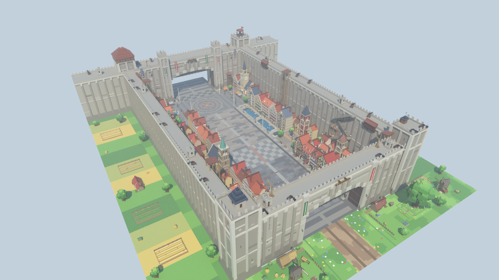

# Zone 7 : ville fortifiée entre des murailles colossales — style stud, pour le jeu Roblox « Volez un œuf »

Septième zone du couloir, après Bleach : une prairie fleurie au pied d'une muraille colossale, une porte
monumentale, puis une ville médiévale européenne serrée entre deux remparts géants, jusqu'à une seconde
muraille dont le tunnel mène à la zone suivante. **Couloir de course vide au centre (90 studs)**, décor tout autour.



| Vue | Fichier |
|---|---|
| Entrée, vue joueur (prairie et porte colossale) | [`rendus/entree.png`](rendus/entree.png) |
| Prairie, fermes et moulins | [`rendus/prairie.png`](rendus/prairie.png) |
| Grand-rue des colombages | [`rendus/rue.png`](rendus/rue.png) |
| Place de l'église | [`rendus/eglise.png`](rendus/eglise.png) |
| Quartier du canal | [`rendus/canal.png`](rendus/canal.png) |
| Grand-place des œufs | [`rendus/place.png`](rendus/place.png), [`rendus/oeufs.png`](rendus/oeufs.png) |
| Muraille intérieure et sortie | [`rendus/final.png`](rendus/final.png) |
| Retour vers la base | [`rendus/retour.png`](rendus/retour.png) |
| Vue de côté / plan de dessus | [`rendus/cote.png`](rendus/cote.png), [`rendus/plan.png`](rendus/plan.png) |

## Ce qu'il y a dans la zone

Dans l'ordre de la course :

1. **La prairie hors les murs** (z 8 → -60) : chemin de terre, herbe semée de fleurs, grand arbre feuillu sur
   sa butte, trois moulins de bois et de pierre, deux fermes, champs, meules, clôtures, poteau indicateur.
   Champs et bosquets se prolongent le long des remparts.
2. **La muraille extérieure** (90 de haut, 24 d'épaisseur) : pierre beige-gris en pixels de 4 tons,
   nervures verticales régulières sur toute la hauteur (y compris au-dessus du tunnel), cordon, corniche,
   chemin de ronde crénelé, canons sur rails, grues de bois, tourelles de guet à toit plat, plateforme de guet
   en bois au-dessus de la porte. **Tunnel de 104 × 46** avec vantaux de bois ouverts et herse relevée.
3. **La place de la porte** : puits, charrette, canon, piles de boulets, escalier et monte-charge contre la muraille.
4. **La grand-rue des colombages** : maisons de 3 à 4 étages (enduit crème, colombages sombres, tuiles
   terre cuite, cheminées, jardinières), enseignes, réverbères, tonneaux, caisses, guirlandes de fanions
   **à 38 studs**. Pavé gris foncé avec bandes de brique tous les 36 studs et caniveaux sombres.
5. **La place de l'église** : église gothique à rosace et clocher, mât de fête, clocher de quartier à droite.
6. **Le quartier du canal** : canal à droite du couloir, ponts de pierre en arc (jamais au-dessus du couloir),
   maisons bourgeoises de pierre sur le quai, marché couvert, second clocher.
7. **La grand-place des œufs** (cercle de rayon 34) : rose des vents pavée, fontaine, beffroi à horloge,
   maisons à arcades, étals du marché.
8. **Le parvis et la muraille intérieure** : dépôt de ravitaillement, tour de guet, muraille de 36 d'épaisseur
   flanquée de deux tours carrées crénelées ; le tunnel débouche sur la zone suivante en z = -548.

Les côtés sont fermés par les **remparts colossaux** (90 de haut) : 6 segments par côté, quatre tours
d'angle, escaliers, monte-charges, canons et chemins de ronde.

## Dimensions (studs)

| Élément | Valeur | Réglage dans `zone.py` |
|---|---|---|
| Couloir de course (vide) | 90 de large, x ∈ [-45, 45] | `DEMI_COULOIR` |
| Trottoirs / façades | jusqu'à \|x\| = 55 | `X_BORD` |
| Entrée → sortie | **548** (sol prolongé de 40 au-delà) | `Z_SORTIE` |
| Murailles | 90 de haut ; extérieure 24 d'épaisseur, intérieure 36 | `H_MUR`, `EP_MUR_EXT`, `EP_MUR_INT` |
| Tunnels de porte | 104 de large, 46 de haut libre | `OUVERTURE`, `H_PASSAGE` |
| Place des œufs | cercle de rayon 34, centre en z = -446 | `Z_PLACE`, `R_PLACE` |
| Largeur entre remparts | 250 (face intérieure en \|x\| = 125) | `X_REMPART` |
| Pièces | ≈ 13 100 (plafond 13 500) | `python zone.py --stats` |

L'origine du modèle est au **centre de l'entrée** (au sol). On arrive par +Z et on court vers **-Z**.
Rien de collidable dans le couloir entre y = 0,05 et 12, rien du tout au-dessus du couloir sous y = 30.

## Importer dans Roblox Studio

**Tester tout de suite :** ouvrir `export/ZoneAttaqueDesTitans-demo.rbxl` (File › Open from File), puis Play.

**Dans votre jeu :**
1. Explorer › clic droit sur `Workspace` › **Insert from File…** › `export/ZoneAttaqueDesTitans.rbxm`.
2. Placer la zone au bout de la zone Bleach, dans la barre de commande :
   `workspace.ZoneAttaqueDesTitans:PivotTo(CFrame.new(X, Y, Z))` avec (X, Y, Z) le centre de l'entrée.
3. Les **repères** invisibles du dossier `ZoneAttaqueDesTitans.Reperes` servent au jeu : `ZoneOeufs`,
   `Entree`, `Sortie`, `Couloir`.

Studs : intégrés à Roblox (matériau Plastic + `SurfaceType.Studs`), aucune image à importer. Texture HD
optionnelle : `require(workspace.ZoneAttaqueDesTitans.Outils.AppliquerStuds)("rbxassetid://VOTRE_ID")`.

## Fichiers

| Fichier | Rôle |
|---|---|
| `zone.py` | Plan de la zone : sols, murailles, ville, places, contrôles (`--stats`, `--chevauchements`) |
| `assets/remparts.py` | Portes colossales, segments de rempart, tours d'angle, escaliers, monte-charges, canons, grues |
| `assets/batiments.py` | Maisons à colombages, bourgeoises, à arcades, maisons de fond, fermes |
| `assets/monuments.py` | Église, clochers, beffroi, fontaine, moulins, dépôt, mât de fête |
| `assets/nature.py` | Arbres, grand arbre, canal et ponts, champs, parterres, buissons |
| `assets/mobilier.py` | Étals, réverbères, tonneaux, puits, charrettes, fanions, enseignes… |
| `kit.py`, `palette.py`, `textures.py` | Kit en Parts Roblox, palette, texture stud et textes |
| `blender_scene.py`, `rendu.py`, `apercu.py` | Scène Blender, rendus de la zone, aperçu d'un asset |
| `roblox_export.luau` | Conversion en fichiers Roblox avec [Lune](https://github.com/lune-org/lune) |
| `CONVENTIONS.md` | Règles de construction des assets |

## Régénérer

```bash
cd roblox/zone-attaque-des-titans
python3.13 -m venv .venv && .venv/bin/pip install bpy==5.2.3 numpy pillow
.venv/bin/python zone.py --stats                     # plan seul, contrôles du couloir et du budget
.venv/bin/python rendu.py --rapide --sans-export --vues entree,rue   # rendus de contrôle
.venv/bin/python rendu.py --res 1600x900 --echantillons 16           # rendus finaux + export (.blend, .rbxm, .rbxl)
```

## Propriété intellectuelle

Uniquement des éléments génériques : ville médiévale européenne, murailles fortifiées, moulins, église,
canal. Aucun nom de la licence ni de lieu de la licence, aucun personnage ni figure humanoïde géante, aucun
visage sur les murs, aucun emblème militaire, aucun équipement de manœuvre. Les enseignes n'utilisent que des
mots de commerce courants (PAIN, AUBERGE, FLEURS, BÄCKEREI, TISSUS, FROMAGES, LIBRAIRIE, HORLOGER, SAVON,
MARCHÉ, FONTAINE). Éviter aussi le nom de la licence dans le titre, les miniatures et le nom affiché de la zone.
