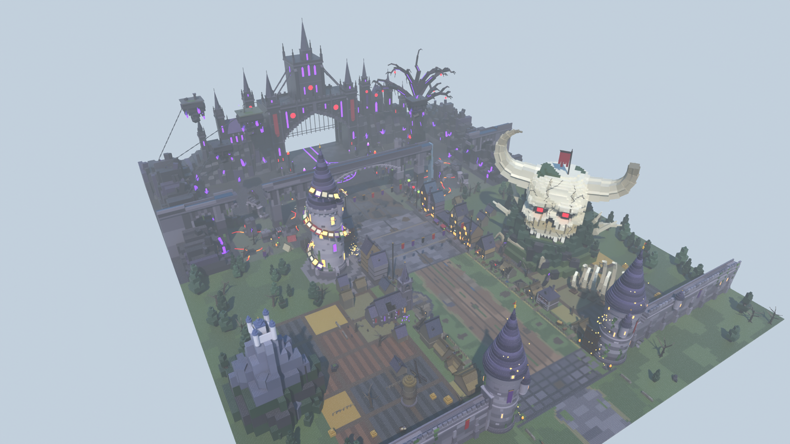

# Zone 8 : royaume des mages aux portes du royaume démoniaque — style stud, pour le jeu Roblox « Volez un œuf »

Huitième zone du couloir (avant-dernière), **après My Hero Academia et avant Attaque des Titans**. On franchit la
porte d'un royaume de mages, on traverse ses confins pauvres dominés par un **crâne de démon cornu**, un bourg
serré autour d'une **tour aux grimoires**, un **champ de bataille de mages** sous un aqueduc brisé, on prend l'œuf
au centre d'un **cercle magique**, et l'on sort par la porte d'un **château démoniaque** noir. Plus on avance, plus
tout devient noir, violet et cramoisi : la zone se lit **sombre et démoniaque même en plein jour**.
**Couloir de course vide au centre (90 studs)**, décor tout autour. `ZoneBlackClover` n'est qu'un nom de fichier
interne, jamais affiché aux joueurs.



| Vue | Fichier |
|---|---|
| Entrée, vue joueur (deux tours à toits en aiguille, le crâne dans l'embrasure) | [`rendus/entree.png`](rendus/entree.png) |
| Rue du village abandonné | [`rendus/village.png`](rendus/village.png) |
| Crâne de démon sur sa colline | [`rendus/crane.png`](rendus/crane.png) |
| Tour aux grimoires et bourg | [`rendus/tour.png`](rendus/tour.png) |
| Champ de bataille des mages et aqueduc | [`rendus/bataille.png`](rendus/bataille.png) |
| Place rituelle des œufs, arbre démoniaque | [`rendus/place.png`](rendus/place.png) |
| Château démoniaque (sortie) | [`rendus/final.png`](rendus/final.png) |
| Retour vers la base | [`rendus/retour.png`](rendus/retour.png) |
| Vue de côté / plan de dessus | [`rendus/cote.png`](rendus/cote.png), [`rendus/plan.png`](rendus/plan.png) |
| Bonus au crépuscule | [`rendus/entree-crepuscule.png`](rendus/entree-crepuscule.png), [`rendus/crane-crepuscule.png`](rendus/crane-crepuscule.png), [`rendus/place-crepuscule.png`](rendus/place-crepuscule.png), [`rendus/final-crepuscule.png`](rendus/final-crepuscule.png) |

Les rendus principaux sont en plein jour, comme dans le jeu (l'éclairage de Roblox est le même partout). Les rendus
au crépuscule montrent l'ambiance que le script d'ambiance sombre (plus bas) donne à la zone.

## Ce qu'il y a dans la zone

Dans l'ordre de la course :

1. **Les abords** (z +40 → 0, groupe `Abords`) : vieille route pavée gris-violet, murets de pierres sèches, sapins
   sombres et arbres morts, poteau indicateur VILLAGE / CHÂTEAU, rochers.
2. **La porte d'entrée** (z 0 → -32) : deux **tours rondes** massives (corps de 58, mâchicoulis, échauguettes) à
   **toits coniques en aiguille** d'ardoise violette (jusqu'à ≈ 111), lierre, bannières unies, vantaux de bois
   cerclés de fer ouverts contre le couloir, enceinte crénelée vers les côtés, braseros. Des **lucioles dorées**
   s'accrochent aux tours (rideau le long de leurs faces et des vantaux, couronne autour des toits). Seuil de
   grandes dalles à joints sombres.
3. **Les champs** (z -32 → -80) : chemin de terre à ornières, grange, chaumières, moulin aux ailes déchirées,
   labours, blé terni et parcelles brûlées, **côtes géantes** d'un démon qui sortent des labours.
4. **Le village abandonné** (z -80 → -196) : chaumières, maisons de pierre (FORGE, AUBERGE) et ruines calcinées ;
   deux tiers des fenêtres sont noires ou condamnées de planches (une bougie à l'auberge et dans deux chaumières).
   À gauche l'église sans croix et son cimetière à feux follets ; à droite, sur sa colline boisée, le **crâne de
   démon cornu** (≈ 120 de haut, cornes comprises) au **regard cramoisi**, l'arrière enfoui sous la forêt, un
   étendard déchiré au sommet. Des racines noires à veine violette sortent du pied de la colline.
5. **Le bourg** (z -196 → -300) : maisons hautes à colombages noirs (une de travers, une à tourelle en aiguille,
   deux maisons de mage aux fioles lumineuses), taverne, halle du marché, enseignes BIBLIOTHÈQUE, POTIONS,
   HERBORISTE ; deux cordes à bannières au-dessus de la rue (**pointes à 34,45**). À gauche, la **tour aux
   grimoires** (Ø 32, toit en aiguille jusqu'à 138) et sa spirale de grimoires volants.
6. **Le champ de bataille des mages** (z -300 → -404) : terre calcinée et cendre, cratères (fissures éteintes dans
   le couloir, incandescentes sur les côtés : rien qui ressemble à de la lave sous les pieds), **douze grands
   bâtons de mage** (≈ 20 de haut, orbes violets, verts, dorés, cramoisis) le long des deux accotements, tours et
   murs en ruine, arcade effondrée, camp de tentes, feux de camp, armes abandonnées, menhirs à marques abstraites.
   L'**aqueduc** sombre enjambe le couloir en z = -352 : arche centrale de 93 de passage libre (dessous à 36),
   grande brèche à droite avec sa cascade, travée tombée à gauche, parapets édentés, travées affaissées.
7. **La place rituelle des œufs** (z -404 → -498) : dalles noires, **cercle magique** de rayon 34 centré en
   z = -448 (anneaux violets, glyphes abstraits, losange cramoisi à nœuds runiques, cœur cramoisi), six
   **obélisques** noirs de 28 à flammes violettes et cramoisies, grandes racines démoniaques, épines, cristaux.
   À droite l'**arbre démoniaque** (≈ 150, tronc torsadé de Ø 30, griffes tendues vers le couloir, vrilles,
   veines violettes) ; haut dans le ciel, quatre **îlots flottants** de roche noire, chacun tenu par une chaîne
   ancrée au sommet des falaises.
8. **Le château démoniaque** (z -498 → -548) : forteresse gothique noire sur sa falaise, **donjon dominant** à la
   plus haute flèche (≈ 199), tours de porte, ailes à flèches, fenêtres violettes, oculi cramoisis. Sa **porte en
   arc brisé** (100 de large, 40 de haut libre) ouvre un tunnel de 50 qui débouche sur la zone suivante en
   z = -548, à travers deux fils de lumière violette au sol.

Sur les côtés : champs et blé, puis lisière de sapins sombres et d'arbres morts ; la montagne couronnée d'un
château (capitale du royaume) au loin à gauche ; à partir du champ de bataille, des falaises noires à cristaux
violets. Des murs invisibles ferment le sol en |x| = 239.

## Dimensions (studs)

| Élément | Valeur | Réglage dans `zone.py` |
|---|---|---|
| Couloir de course (vide) | 90 de large, x ∈ [-45, 45] | `DEMI_COULOIR` |
| Accotements / façades | jusqu'à \|x\| = 55 | `X_BORD` |
| Entrée → sortie | **548** (abords de 40 en plus, groupe `Abords`) | `Z_SORTIE`, `Z_ABORDS` |
| Largeur du sol | 478 (\|x\| ≤ 239) | `X_FOND` |
| Porte d'entrée | 100 entre les tours, tours de 58 (toits jusqu'à ≈ 111) | `OUVERTURE_PORTE`, `H_TOUR_PORTE` |
| Aqueduc (z = -352) | 93 de passage libre entre les socles, dessous à 36, tablier à 62 | `Z_AQUEDUC`, `DESSOUS_AQUEDUC`, `H_AQUEDUC` |
| Place des œufs | cercle de rayon 34, centre en z = -448 | `Z_PLACE`, `R_PLACE` |
| Porte du château | 100 × 40 (arc brisé au-dessus), tunnel de 50 | `OUVERTURE`, `H_PASSAGE`, `PROF_CHATEAU` |
| Grands repères | crâne ≈ 120, tour aux grimoires 138, arbre 150, donjon ≈ 199 | `H_TOUR`, `H_ARBRE` |
| Pièces | **13 275**, dont 892 Neon (plafond 13 500) | `python zone.py --stats` |

L'origine du modèle est au **centre de l'entrée** (au sol, z = 0). On arrive par +Z et on court vers **-Z**.
Rien de collidable dans le couloir entre y = 0,05 et 12, rien du tout au-dessus du couloir sous y = 30 ; ce qui
enjambe le couloir (cordes à bannières, aqueduc, porte du château) garde son dessous à 34 ou plus.

## Importer dans Roblox Studio

**Tester tout de suite :** ouvrir `export/ZoneBlackClover-demo.rbxl` (File › Open from File), puis Play.

**Dans votre jeu :**
1. Explorer › clic droit sur `Workspace` › **Insert from File…** › `export/ZoneBlackClover.rbxm`
   (ou glisser le fichier dans la fenêtre de Studio).
2. Placer la zone au bout de la zone My Hero Academia, dans la barre de commande :
   `workspace.ZoneBlackClover:PivotTo(CFrame.new(X, Y, Z))` avec (X, Y, Z) le centre de l'entrée (la sortie de la
   zone précédente). La zone Attaque des Titans se pose ensuite au centre de la sortie, 548 studs plus loin vers -Z.
3. **Abords** : le groupe `ZoneBlackClover.Abords` (route, arbres et sol devant l'entrée, z 0 → +40) déborde sur la
   zone précédente. Supprimez-le quand les zones sont mises bout à bout.
4. Les **repères** invisibles du dossier `ZoneBlackClover.Reperes` servent au jeu : `ZoneOeufs` (zone des œufs),
   `Entree`, `Sortie`, `Couloir`.

**Studs** : intégrés à Roblox (matériau Plastic + `SurfaceType.Studs`), aucune image à importer. Texture HD
optionnelle : `require(workspace.ZoneBlackClover.Outils.AppliquerStuds)("rbxassetid://VOTRE_ID")` (image
`textures/stud.png` à téléverser) ; le mode « materiau » crée le MaterialVariant `StudsZone8`.

## Ambiance sombre dans la zone

L'éclairage de Roblox vaut pour tout le jeu. Pour que la zone paraisse sombre et démoniaque sans assombrir les
autres, le modèle contient un petit script local.

**Ce qu'il fait**
- Tant que le personnage du joueur est dans la zone, l'éclairage glisse en 2 secondes vers un crépuscule violet et
  cramoisi : soleil couché (`ClockTime` 18,2) ; lumière plus faible et violette (`Brightness`, `Ambient`,
  `OutdoorAmbient`) ; brume violette, cramoisie du côté opposé au soleil (`Atmosphere` : `Color`, `Decay`,
  `Density`, `Haze`, `Glare`) ; légère teinte violette plus contrastée (un `ColorCorrectionEffect` propre à la
  zone, ajouté par-dessus celui du jeu).
- Quand il en sort (par l'entrée, par la sortie, ou en réapparaissant à sa base), les valeurs d'origine reviennent
  à l'identique. Ce qui a été créé pour l'occasion (la teinte, et l'`Atmosphere` si le jeu n'en avait pas, nommées
  `AmbianceZone8`) est supprimé.
- L'effet est propre à chaque joueur : rien ne change sur le serveur ni chez les autres joueurs, et les autres
  zones ne sont pas concernées.
- **La zone** est la boîte qui englobe toutes ses pièces, enregistrée dans les attributs `BornesMin` et
  `BornesMax` du modèle (recalculés à chaque export, en studs comptés depuis le pivot). Elle suit le modèle déplacé
  avec `PivotTo`, même tourné, et ne dépend pas des pièces chargées : le script fonctionne avec `StreamingEnabled`.
  Une marge de 6 studs à la sortie évite le clignotement en bordure. La boîte inclut les Abords : si vous les
  supprimez, il n'y a rien à changer.

**Installer dans votre jeu**
1. Insérez `ZoneBlackClover.rbxm` comme d'habitude (Workspace, puis `PivotTo`).
2. Dans l'Explorer, déplacez (ou copiez) le LocalScript **ZoneBlackClover › Outils › AmbianceZone8** dans
   **StarterPlayer › StarterPlayerScripts** (rangé dans le modèle, il ne s'exécute pas ; ne le mettez pas dans
   StarterCharacterScripts).
3. C'est tout. Le script attend `workspace.ZoneBlackClover`, puis lance le module **Outils › Ambiance** du modèle :
   ```lua
   local zone = workspace:WaitForChild("ZoneBlackClover", math.huge)
   require(zone:WaitForChild("Outils"):WaitForChild("Ambiance"))(zone)
   ```
   Si la zone est renommée ou rangée dans un dossier, adaptez le chemin, par exemple
   `workspace:WaitForChild("Zones"):WaitForChild("ZoneBlackClover", math.huge)`.

La place de démonstration `ZoneBlackClover-demo.rbxl` est déjà branchée : on y apparaît dans la zone, le ciel
s'assombrit dès l'apparition. Pour comparer en Play, décochez l'attribut `AmbianceActive` du modèle.

**Régler** : table `REGLAGES` en tête du ModuleScript Outils › Ambiance (`duree` du fondu, 2 s ; `periode` entre
deux relevés de position, 0,2 s ; `marge`, 6 studs ; valeurs visées pour `Lighting`, `Atmosphere` et
`ColorCorrectionEffect`). Seules les propriétés listées sont modifiées : on peut en retirer, ou en ajouter (par
exemple `ExposureCompensation = -0.3` dans `Lighting` pour plus sombre encore). L'étendue : attributs `BornesMin` et
`BornesMax` du modèle.

**Couper** : décochez l'attribut `AmbianceActive` du modèle (l'éclairage d'origine revient, même en cours de
partie ; un script serveur peut aussi le changer), ou supprimez le LocalScript de StarterPlayerScripts.

**Limites** : si votre jeu modifie lui-même l'éclairage pendant que le joueur est dans la zone (cycle jour/nuit,
autre script d'ambiance), ces changements prennent le dessus et la zone remet à la sortie les valeurs relevées à
l'entrée ; avec un cycle jour/nuit, retirez `ClockTime` des réglages. Une seule ambiance de ce genre à la fois : la
boîte d'une autre zone ne doit pas chevaucher celle-ci. Vérifié hors de Roblox avec Lune (entrées, sorties,
réapparition, `PivotTo` avec rotation, streaming, jeu sans `Atmosphere`) : faites tout de même un essai en Play.

## Fichiers

| Fichier | Rôle |
|---|---|
| `zone.py` | Plan de la zone : sols, séquences, îlots, contrôles (`--stats`, `--chevauchements`) |
| `assets/remparts.py` | Porte d'entrée et enceinte, tours et murs en ruine, arcades effondrées, aqueduc |
| `assets/batiments.py` | Chaumières, maisons de pierre, ruines, grange, moulin, église, maisons hautes, taverne, halle |
| `assets/monuments.py` | Crâne de démon et sa colline, côtes géantes, tour aux grimoires, montagne de la capitale |
| `assets/abime.py` | Château démoniaque et sa falaise, arbre démoniaque, îlots flottants, falaises, obélisques, racines, cristaux |
| `assets/mobilier.py` | Lanternes, braseros, bâtons de mage, armes, feux, tonneaux, enseignes, bannières, lucioles, arbres… |
| `kit.py`, `palette.py`, `textures.py` | Kit en Parts Roblox, palette sombre, texture stud et textes |
| `blender_scene.py`, `rendu.py`, `apercu.py` | Scène Blender, rendus de la zone, aperçu d'un asset |
| `roblox_export.luau` | Conversion en fichiers Roblox avec [Lune](https://github.com/lune-org/lune), outils et ambiance |
| `CONVENTIONS.md`, `CONCEPTION.md`, `SPECS.md` | Règles de construction, intention et séquence, fiches des assets |
| `export/` | `ZoneBlackClover.rbxm` (modèle), `ZoneBlackClover-demo.rbxl` (place de démo), `ZoneBlackClover.blend` |

## Régénérer

```bash
cd roblox/zone-black-clover
python3.13 -m venv .venv && .venv/bin/pip install bpy==5.2.3 numpy pillow
.venv/bin/python zone.py --stats                       # plan seul, contrôles du couloir, de la hauteur libre et du budget
.venv/bin/python zone.py --chevauchements              # assets posés qui se recoupent
.venv/bin/python rendu.py --rapide --sans-export --vues entree,bataille     # rendus de contrôle
.venv/bin/python rendu.py --res 1600x900 --echantillons 16 --sans-export    # rendus finaux
.venv/bin/python rendu.py --sans-export --res 1600x900 --echantillons 16 --ambiance crepuscule \
    --suffixe=-crepuscule --vues entree,crane,place,final                    # rendus bonus au crépuscule
.venv/bin/python rendu.py --sans-rendu                 # export : .blend, .glb, puis .rbxm et -demo.rbxl via Lune
```

## Propriété intellectuelle

Uniquement de la fantasy sombre générique : village médiéval, tour de mages, ruines, aqueduc, château gothique,
crâne de démon, arbre noir, cercle magique. Aucun nom de la licence, de ses lieux, escouades, personnages, sorts ou
démons (ni dans les textes, ni dans les noms de pièces ou de groupes ; le script d'ambiance et le MaterialVariant
portent des noms neutres : `AmbianceZone8`, `StudsZone8`). Aucun personnage, statue ni silhouette humanoïde, rien
sur le crâne qu'un étendard uni, deux orbites seulement. **Aucune forme de trèfle**, aucun emblème ni blason :
bannières et boucliers unis, grimoires à couvertures unies. Cercle magique et marques des menhirs abstraits : ni
étoile, ni lettre, ni symbole religieux. Les enseignes n'utilisent que des mots français courants (TAVERNE,
AUBERGE, GRIMOIRES, MARCHÉ, FORGE, BIBLIOTHÈQUE, HERBORISTE, POTIONS) et le poteau indicateur VILLAGE / CHÂTEAU.
Éviter aussi le nom de la licence dans le titre, les miniatures et le nom affiché de la zone.
