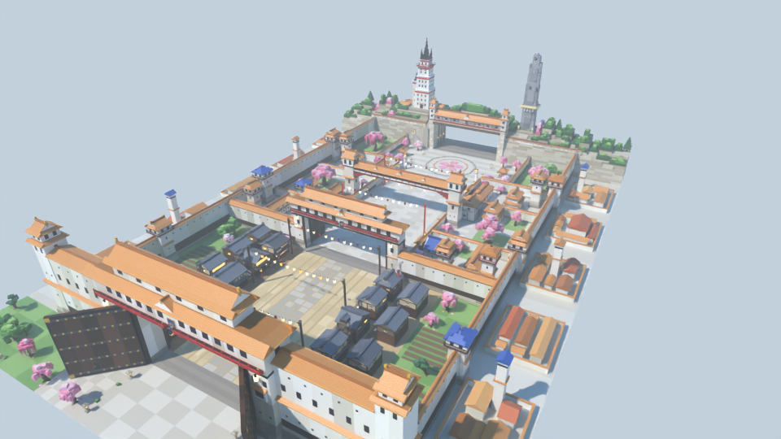

# Zone 6 « la cité blanche aux toits ocre » — style stud, pour le jeu Roblox « Volez un œuf »

Sixième zone du couloir, après Naruto, One Piece, Demon Slayer, Dragon Ball et Jujutsu Kaisen : une
ville-forteresse céleste aux murs blancs et aux toits de tuiles ocre. On entre par une porte colossale, on
traverse un faubourg de bois sombre, puis une cité blanche aux longs murs, on prend son œuf dans une grande cour
pavée et on repart. La colline de la grande tour blanche et du monolithe ferme la perspective.
**Couloir de course vide de 90 studs de large au centre**, décor tout autour.



| Vue | Fichier |
|---|---|
| Entrée, vue joueur (grande porte blanche 門) | [`rendus/entree.png`](rendus/entree.png) |
| Rue du faubourg | [`rendus/faubourg.png`](rendus/faubourg.png) |
| Le grand mur blanc vu de l'intérieur | [`rendus/revers.png`](rendus/revers.png) |
| Allée de la cité blanche | [`rendus/cite.png`](rendus/cite.png) |
| Passerelle laquée et tours blanches | [`rendus/tours.png`](rendus/tours.png) |
| Cour des œufs, colline, tour et monolithe | [`rendus/place.png`](rendus/place.png) |
| Repère final (tour, monolithe, tunnel) | [`rendus/colline.png`](rendus/colline.png) |
| Retour vers la base | [`rendus/retour.png`](rendus/retour.png) |
| Vue de côté / plan de dessus | [`rendus/cote.png`](rendus/cote.png), [`rendus/plan.png`](rendus/plan.png) |

## Ce qu'il y a dans la zone

Dans l'ordre de la course :

1. **L'esplanade et la grande porte blanche** : un mur d'enceinte blanc de 64 studs à chaperon de tuiles ocre,
   sur une base de pierre en gradins, avec deux tours d'angle, deux bastions à bretèche et un corps de garde à
   deux toits ocre, balcons laqués rouges et plaque 門. Les deux vantaux géants, enduits de blanc comme des portes
   d'entrepôt japonais (cadre laqué noir, bandes de fer cloutées d'or, petit guichet), sont ouverts vers
   l'extérieur et bordent l'esplanade. Lanternes de pierre, cerisiers, pins.
2. **Le faubourg** : une rue de sable doré avec un chemin central de grandes dalles, huit maisons de marchands à
   étage en bois sombre et tuiles grises (thé 茶, auberge 宿, riz 米, soba 蕎麦, confiserie 甘味, bains 湯), avec
   balcons, stores de bambou, rideaux de boutique et lanternes. Dans les ruelles : échoppes, puits, seaux
   d'incendie, bannières, trois tours de guet en bois à cloche. Trois guirlandes de lampions au-dessus de la rue,
   une petite place plantée de cerisiers devant la porte intérieure et deux cerisiers géants derrière les toits.
3. **La porte intérieure** : une tour-porte blanche à corps de garde, balcons rouges et plaque 静. Ses vantaux de
   bois sombre sont ouverts côté faubourg : passé la porte, tout devient blanc.
4. **La cité blanche** : l'allée court entre deux longs murs blancs de 14 studs à chaperon ocre. Au sol, un
   chemin central de grandes dalles chaudes, un liseré ocre et un joint sombre tous les 24 studs
   (repère de vitesse). Trois enclos par côté, chacun avec son portail à petit toit (静 茶 白 宿 門) et une maison
   blanche à étage aux toits ocre (un hall à toit bleu par côté). Tours de guet blanches, cerisiers qui débordent
   des murs, cerisiers géants, jardin à étang et pont rouge, lanternes. Une **passerelle couverte laquée rouge**
   enjambe l'allée à 38 studs entre deux tours blanches.
5. **La cour des œufs** : une grande cour pavée fermée de murs blancs de 16 studs, encadrée à l'entrée par deux
   tours blanches, avec au centre une **mosaïque de fleur de cerisier** (rayon 34) dans un cadre de pierre
   sombre. Pavillons à piliers rouges, lanternes de pierre, cerisiers.
6. **La colline** : un mur de soutènement de pierre pâle percé d'un **tunnel de 96 de large** (sortie vers la
   zone suivante) sous un corps de garde blanc ; derrière, une butte boisée de cèdres. À gauche, la **grande tour
   blanche** à bandes rouges, jupes de tuiles et flèches sombres (sommet vers 149) ; à droite, un **monolithe
   de pierre** grise ceint d'une corde sacrée à papiers blancs (sommet vers 143), sur sa terrasse.

Des remparts blancs de 28 studs à tours ferment les côtés ; au-delà, une ville lointaine d'enclos blancs à toits
ocre donne l'échelle d'une cité immense.

## Dimensions (studs)

| Élément | Valeur | Réglage dans `zone.py` |
|---|---|---|
| Couloir de course (vide) | **90 de large**, x ∈ [-45, 45] | `DEMI_COULOIR` |
| Sol praticable (couloir + trottoirs) | 110 de large, \|x\| < 55 | `X_BORD` |
| Grande porte → sortie du tunnel | **522** (zone entière avec l'esplanade : 586) | `Z_SORTIE`, `Z_APPROCHE` |
| Esplanade devant la grande porte | de z = +64 à +8 | `Z_APPROCHE` |
| Grande porte | ouverture 100 × 55 (sous les solives), mur de 64 | `OUVERTURE_PORTE` |
| Porte intérieure | z = -176, passage 92 × 35 | `Z_PORTE_INT`, `OUVERTURE_PORTE_INT` |
| Murs d'allée de la cité | 14 de haut, faces en \|x\| = 55 | `H_MUR_ALLEE`, `X_BORD` |
| Passerelle laquée | z = -286, portée 130, dessous à 36,6 | `Z_PASSERELLE`, `PORTEE_PASSERELLE` |
| Place des œufs | cercle de rayon 34, centre en z = -430 | `Z_PLACE`, `R_PLACE` |
| Tunnel de sortie | 96 de large, 38 de haut, z -476 → -522 | `PASSAGE_TUNNEL`, `Z_COLLINE` |
| Largeur totale | 300 entre les remparts, 420 avec la ville lointaine | `X_ENCEINTE`, `X_FOND` |
| Repères verticaux | grande porte 104, tour blanche 149, monolithe 143 | — |
| Pièces | **12 809** (plafond 13 500) | `PLAFOND` |

Au-dessus du couloir, rien ne descend sous 34 studs (lampions des guirlandes à 34, solives de la porte
intérieure à 35, voûte du tunnel à 38) : la caméra Roblox ne saute pas. Au sol, rien de solide dans |x| < 45.

L'origine du modèle est au **centre de l'entrée** : au sol, au milieu du mur de la grande porte. Les joueurs
arrivent par +Z et courent vers **-Z**. L'esplanade déborde de **64 studs** devant l'origine (vers +Z) et la
sortie est en z = -522.

## Importer dans Roblox Studio

**Tester tout de suite :** ouvrir `export/ZoneBleach-demo.rbxl` (File › Open from File), puis Play. La place
contient la zone, l'éclairage des rendus et un point d'apparition sur l'esplanade.

**Dans votre jeu :**
1. Explorer › clic droit sur `Workspace` › **Insert from File…** › `export/ZoneBleach.rbxm`
   (ou glisser le fichier dans la fenêtre de Studio).
2. Placer la zone au bout de la zone Jujutsu Kaisen, dans la barre de commande :
   `workspace.ZoneBleach:PivotTo(CFrame.new(X, Y, Z))`, avec (X, Y, Z) le centre de l'entrée.
   **Attention à l'esplanade** : elle occupe les 64 studs devant l'origine. Si la sortie de la zone précédente
   est au point (Xs, Ys, Zs), utiliser `CFrame.new(Xs, Ys, Zs - 64)` pour que l'esplanade commence juste à la
   sortie, sans recouvrir la zone précédente. Le sol du tunnel s'arrête net en z = -522, au début de la zone
   suivante.
3. Les **repères** invisibles du dossier `ZoneBleach.Reperes` servent au jeu : `ZoneOeufs` (où poser les
   œufs), `Entree`, `Sortie`, `Couloir`.
4. Le nom du modèle `ZoneBleach` est un nom de fichier interne : le renommer dans Studio (par exemple
   `ZoneCiteBlanche`) avant de publier (voir « Propriété intellectuelle »).

**Studs.** Les faces concernées utilisent les studs intégrés de Roblox (matériau *Plastic* +
`SurfaceType.Studs`) : aucune image à importer, la couleur suit celle de la pièce. Pour des studs plus nets
(texture HD), importer `textures/stud.png` (Asset Manager), puis dans la barre de commande :

```lua
require(workspace.ZoneBleach.Outils.AppliquerStuds)("rbxassetid://VOTRE_ID")
-- revenir aux studs intégrés : require(workspace.ZoneBleach.Outils.AppliquerStuds)(nil)
```

**Performance.** Toutes les pièces sont ancrées. Les petits détails (feuillages, ferrures, barreaux, lampions,
enseignes…) sont non solides (`CanCollide`, `CanQuery` et `CanTouch` désactivés). Les grands ensembles (sol,
remparts, ville lointaine, colline, grande porte) sont rangés en blocs de 64 × 64 studs pour le streaming.

## Fichiers

| Fichier | Rôle |
|---|---|
| `zone.py` | Plan de la zone : sol, remparts, placement de tous les assets, contrôles (`--stats`) |
| `assets/remparts.py` | Grande porte, porte intérieure, passerelle laquée, murs blancs, tours blanches, portails d'enclos |
| `assets/batiments.py` | Maisons de bois du faubourg, échoppes, tours de guet, maisons blanches, casernes, pavillons, ville lointaine |
| `assets/vegetation.py` | Cerisiers, cerisiers géants, pins, massifs, buissons, rochers, étang à pont rouge |
| `assets/colline.py` | Colline finale : mur de soutènement, tunnel, corps de garde, grande tour blanche, monolithe, butte boisée |
| `assets/mobilier.py` | Lanternes, mâts et guirlandes de lampions, bannières, puits, seaux, étals, charrette… |
| `kit.py`, `palette.py`, `textures.py` | Kit en Parts Roblox, palette, texture stud et textes |
| `blender_scene.py`, `rendu.py`, `apercu.py` | Scène Blender, rendus, export `.blend` / `.glb`, aperçu d'un asset |
| `roblox_export.luau` | Conversion en fichiers Roblox avec [Lune](https://github.com/lune-org/lune) |
| `CONCEPTION.md`, `CONVENTIONS.md` | Intention, séquence, budgets ; règles de construction des assets |
| `export/` | `ZoneBleach.rbxm` (modèle), `ZoneBleach-demo.rbxl` (place de démo), `.rbxmx`, `.blend`, `.glb` |

## Régénérer

```bash
cd roblox/zone-bleach
python3.13 -m venv .venv && .venv/bin/pip install bpy==5.2.3 numpy pillow
.venv/bin/python zone.py --stats                                  # plan seul : pièces, couloir, budgets, chevauchements
.venv/bin/python rendu.py --rapide --sans-export --vues entree,cite  # rendus de contrôle
.venv/bin/python rendu.py --res 1600x900 --echantillons 16        # rendus finaux + export (.blend, .glb, .rbxm, .rbxl)
.venv/bin/python apercu.py assets.remparts:grande_porte --variant 0  # aperçu d'un asset seul
```

`rendu.py` cherche Lune dans `$LUNE`, dans le `PATH` ou dans le dossier d'outils du projet ; sans Lune, il
écrit seulement le `.blend` et le `.glb`.

## Propriété intellectuelle

Uniquement des éléments japonais génériques : enceintes de château blanches, tours de guet, maisons d'Edo,
cerisiers, pierre sacrée à corde *shimenawa*. Aucun nom de la licence (ni lieu ni personnage), aucun personnage,
aucun numéro de division, aucun insigne, pas de 護廷, 十三隊, 霊 ou 隊, pas de sabre, de masque ni de hallebarde
géante. Les enseignes n'utilisent que des mots courants (門, 静, 白, 茶, 宿, 米, 湯, 薬, 団子, 蕎麦, 甘味, 呉服).
Le nom de la licence n'apparaît que dans le nom interne du modèle (`ZoneBleach`) et des fichiers : renommer le
modèle dans Studio, et éviter ce nom dans le titre, les miniatures et le nom affiché de la zone.
