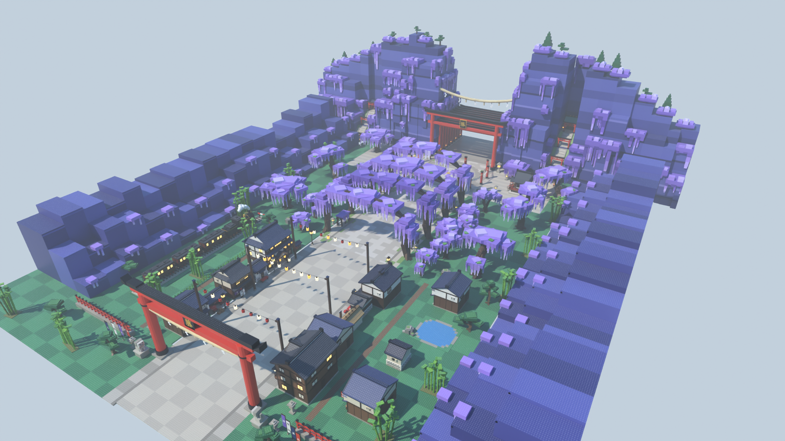

# Zone Demon Slayer (village Taishō et glycines) — style stud, pour le jeu Roblox « Volez un œuf »

Troisième zone du couloir, après Naruto et One Piece : un village japonais de l'ère Taishō, une allée
de glycines en tunnel, la place des œufs entourée de piliers vermillon, puis la montagne aux glycines
traversée par un tunnel de torii. **Couloir de course vide au centre**, décor tout autour.



| Vue | Fichier |
|---|---|
| Entrée, vue joueur (grand torii 藤) | [`rendus/entree.png`](rendus/entree.png) |
| Rue du village | [`rendus/village.png`](rendus/village.png) |
| Allée des glycines | [`rendus/glycines.png`](rendus/glycines.png) |
| Place des œufs et sanctuaire | [`rendus/place.png`](rendus/place.png) |
| Montagne et tunnel de torii | [`rendus/montagne.png`](rendus/montagne.png) |
| Retour vers la base | [`rendus/retour.png`](rendus/retour.png) |
| Vue de côté / plan de dessus | [`rendus/cote.png`](rendus/cote.png), [`rendus/plan.png`](rendus/plan.png) |
| Bonus au crépuscule | [`rendus/glycines-crepuscule.png`](rendus/glycines-crepuscule.png), [`rendus/place-crepuscule.png`](rendus/place-crepuscule.png), [`rendus/village-crepuscule.png`](rendus/village-crepuscule.png) |

## Ce qu'il y a dans la zone

Dans l'ordre de la course :

1. **Le grand torii vermillon** : plaque 藤 (glycine), corde sacrée et papiers en zigzag, chiens-lions
   gardiens, lanternes de pierre, bannières, clôture de sanctuaire.
2. **Le village de l'ère Taishō** : maisons marchandes (machiya), auberges à balcons éclairés, maisons de
   thé à parasol rouge, entrepôts (kura), stands de rue, réverbères à gaz, guirlandes de lampions **au-dessus
   de 30 studs**. Derrière : un **train à vapeur** à quai, un étang, des bambous et des pins.
3. **L'allée des glycines** : quatre grandes arches fleuries au-dessus du couloir, des glycines en cascades
   de part et d'autre, des treilles sur les trottoirs, des glycines géantes et des bambous au second plan.
4. **La place des œufs** : dallage circulaire avec une fleur de glycine, anneau de piliers vermillon reliés
   par des cordes à papiers, sanctuaire, pavillon d'eau 清水, glycines géantes.
5. **La montagne aux glycines** : falaises bleu-violet couvertes de glycines, gorge à ciel ouvert avec dix
   torii en tunnel et un grand torii à la plaque 藤, escaliers vers un petit sanctuaire et un pavillon.

Des falaises bleu-violet couronnées de glycines ferment les deux côtés de la vallée.

## Dimensions (studs)

| Élément | Valeur | Réglage dans `zone.py` |
|---|---|---|
| Couloir de course (vide) | 60 de large, x ∈ [-30, 30] | `DEMI_COULOIR` |
| Sol praticable (couloir + trottoirs) | 80 de large | `X_FACADE` |
| Torii → façade de la montagne | 376 | `Z_MONTAGNE` |
| Torii → sortie de la gorge | **444** (Naruto : 364) | `PROF_MONTAGNE` |
| Place des œufs | cercle de rayon 34, centre en z = -334 | `Z_PLACE`, `R_PLACE` |
| Largeur totale | 260 entre les falaises, 400 avec elles | `X_FALAISE`, `X_FOND` |
| Gorge de la montagne | 68 de large, ouverte vers le ciel | appel `montagne_glycines(...)` |

L'origine du modèle est au **centre de l'entrée** (sol du grand torii). L'avant de la zone est vers **-Z**.

## Importer dans Roblox Studio

**Tester tout de suite :** ouvrir `export/ZoneDemonSlayer-demo.rbxl` (File › Open from File), puis Play.

**Dans votre jeu :**
1. Explorer › clic droit sur `Workspace` › **Insert from File…** › `export/ZoneDemonSlayer.rbxm`
   (ou glisser le fichier dans la fenêtre de Studio).
2. Placer la zone au bout de la zone One Piece, dans la barre de commande :
   `workspace.ZoneDemonSlayer:PivotTo(CFrame.new(X, Y, Z))` avec (X, Y, Z) le centre de l'entrée.
3. Les **repères** invisibles du dossier `ZoneDemonSlayer.Reperes` servent au jeu : `ZoneOeufs`,
   `Entree`, `Sortie`, `Couloir`.

Studs : intégrés à Roblox (matériau Plastic + `SurfaceType.Studs`), aucune image à importer. Texture HD
optionnelle : `require(workspace.ZoneDemonSlayer.Outils.AppliquerStuds)("rbxassetid://VOTRE_ID")`.

**Éclairage.** Les rendus principaux sont en plein jour, comme dans le jeu. Les rendus « crépuscule » montrent
la zone au soleil couchant (lanternes allumées) : on peut obtenir cet effet dans Roblox en changeant
`Lighting.ClockTime` (≈ 17.8) quand le joueur entre dans la zone, avec un script local.

## Fichiers

| Fichier | Rôle |
|---|---|
| `zone.py` | Plan de la zone : sol, falaises, placement de tous les assets |
| `assets/porte.py` | Grand torii d'entrée, chiens-lions, lanternes, bannières, clôture |
| `assets/batiments.py` | Machiya, auberge, maison de thé, kura, sanctuaire, pavillon d'eau, stand |
| `assets/glycines.py` | Glycines, glycines géantes, arches, treilles, bambous, pins, rochers |
| `assets/montagne.py` | Montagne aux glycines (gorge, tunnel de torii, sanctuaire) et train à vapeur |
| `assets/mobilier.py` | Piliers vermillon, cordes à papiers, lampions, lanternes, réverbères à gaz… |
| `kit.py`, `palette.py`, `textures.py` | Kit en Parts Roblox, palette, texture stud et textes |
| `blender_scene.py`, `rendu.py` | Scène Blender, rendus (`--ambiance crepuscule`), export `.blend` |
| `roblox_export.luau` | Conversion en fichiers Roblox avec [Lune](https://github.com/lune-org/lune) |
| `CONVENTIONS.md` | Règles de construction des assets |

## Régénérer

```bash
cd roblox/zone-demon-slayer
python3.13 -m venv .venv && .venv/bin/pip install bpy==5.2.3 numpy pillow
.venv/bin/python rendu.py                                    # rendus de jour + export (.blend, .rbxm, .rbxl)
.venv/bin/python rendu.py --sans-export --ambiance crepuscule --suffixe -crepuscule --vues glycines,place
python3 zone.py --stats                                      # plan seul, nombre de pièces par groupe
```

## Propriété intellectuelle

Uniquement des éléments japonais génériques : glycines, torii, sanctuaires, maisons de l'ère Taishō, train
à vapeur. Aucun nom de la licence, aucun personnage, pas de kanji 滅 ni 鬼殺隊, pas de motif de haori ni de
boucles d'oreilles hanafuda, pas de blason. Les enseignes n'utilisent que des mots courants (茶, 団子, 蕎麦,
甘味, 呉服, 薬, 宿, 藤, 清水). Éviter aussi « Demon Slayer » et « Kimetsu » dans le titre, les miniatures et le
nom affiché de la zone.
