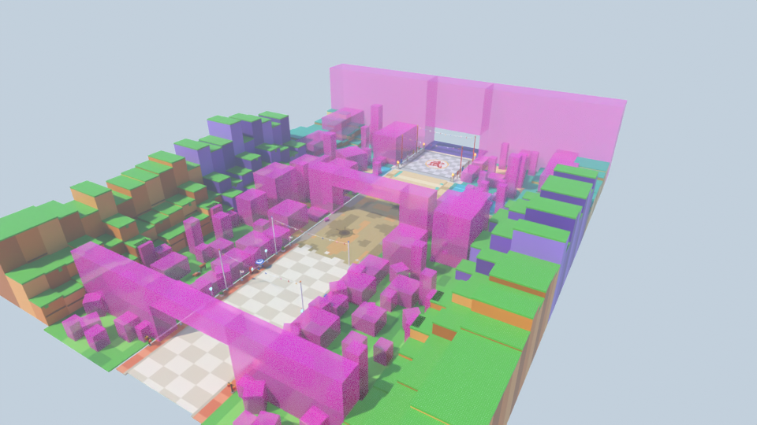

# Zone 4 « arts martiaux » (campagne, terres de combat, planète) — style stud, pour le jeu Roblox « Volez un œuf »

Quatrième zone du couloir, après Naruto, One Piece et Demon Slayer. Trois paysages génériques se suivent dans
une seule course : une campagne de maisons-dômes rétro-futuristes, une plaine de combat semée de mesas
violettes, puis une planète extraterrestre bleu-vert. La place des œufs est une arène d'arts martiaux, et la
zone se termine sous une arche de roche géante enveloppée de nuages dorés.
**Couloir de course vide au centre (90 studs)**, décor tout autour.



| Vue | Fichier |
|---|---|
| Entrée, vue joueur (porte de temple 武道) | [`rendus/entree.png`](rendus/entree.png) |
| Rue des maisons-dômes | [`rendus/village.png`](rendus/village.png) |
| Terres de combat et pont de roche | [`rendus/friche.png`](rendus/friche.png) |
| Planète : lac, îlots, dômes | [`rendus/alien.png`](rendus/alien.png) |
| Planète : vaisseau et canal | [`rendus/vaisseau.png`](rendus/vaisseau.png) |
| Place des œufs (arène) | [`rendus/place.png`](rendus/place.png) |
| Arche finale et nuages dorés | [`rendus/arche.png`](rendus/arche.png) |
| Retour vers la base | [`rendus/retour.png`](rendus/retour.png) |
| Vue de côté / plan de dessus | [`rendus/cote.png`](rendus/cote.png), [`rendus/plan.png`](rendus/plan.png) |

## Ce qu'il y a dans la zone

Dans l'ordre de la course (on court vers -Z) :

1. **La porte de temple** (z = 0) : piliers rouges, double toit de tuiles orange, plaque 武道, murs blancs
   jusqu'aux falaises. Devant elle (groupe `Approche`) : lions de pierre, lanternes, palmiers.
2. **La campagne** (0 → -146) : grandes maisons-dômes blanches sur tambour à bandes colorées (dont une à
   tourelle-dôme et une à deux dômes reliés), boutiques rondes à objet géant (cornet de glace, beignet),
   palmiers géants, lampadaires, fanions au-dessus de la rue (≥ 34 studs), rosace et chevrons peints au sol.
   Au second plan : dojo 道場 et terrain d'entraînement, pagodes, dômes, pitons orange, falaises orange à
   bandes avec quatre cascades.
3. **Les terres de combat** (-146 → -282) : plaine verte trouée d'ocre avec une piste centrale claire,
   seize mesas violettes à sommet herbu (trois géantes de 60 à 72 studs, deux colonnes près du trottoir),
   cratères, rochers, traces d'impact peintes, et un **pont de roche naturel** au-dessus du couloir (z = -214).
   Les falaises lavande sont basses : les mesas se découpent sur le ciel.
4. **La planète extraterrestre** (-282 → -344) : deux pitons de sable géants en quinconce, canaux turquoise
   avec passerelles blanches, lac et îlots, arbres « boules », dômes et hameau de dômes reliés, grand
   vaisseau rond sur pattes, bancs de nuages dorés derrière les falaises de sable.
5. **La place des œufs** : arène carrée 96 × 80 en dalles (dessus à 1,5 stud) qui couvre tout le couloir,
   grand 武 au centre, marches sur les côtés, poteaux à flamme aux coins ; temple aux toits orange à gauche,
   grandes tribunes, gong et pagode à droite ; bannières 武 / 気 / 修行 / 武道 ; fanions au-dessus.
6. **L'arche finale** (façade z = -436) : arche de roche sable et violette, deux cascades, deux pitons géants
   coiffés d'arbres, deux grands bancs de nuages dorés ; le couloir sort dessous vers la zone suivante (z = -470).

## Dimensions (studs)

| Élément | Valeur | Réglage dans `zone.py` |
|---|---|---|
| Couloir de course (vide) | 90 de large, x ∈ [-45, 45] | `DEMI_COULOIR` |
| Trottoirs / premières façades | jusqu'à \|x\| = 55 / \|x\| ≥ 56 | `X_BORD`, `X_FACADE` |
| Porte → sortie sous l'arche | **470** (z = 0 → -470) | `Z_SORTIE` |
| Approche devant la porte | 48 (groupe `Approche`, supprimable) | `Z_APPROCHE` |
| Pont de roche | z = -214, 108 entre les piles, dessous ≥ 34,5 | `Z_PONT` |
| Arène des œufs | 96 × 80, centre z = -389, dessus y = 1,5 | `Z_PLACE`, `AX_ARENE`, `AZ_ARENE` |
| Passage sous l'arche | 104 de large sous y = 22, 96 entre 22 et 40 | `PASSAGE` |
| Largeur totale | 270 entre les falaises, 432 avec elles | `X_FALAISE`, `X_FOND` |
| Pièces | ≈ 11 000 (budget 13 500) | `python zone.py --stats` |

Règles tenues (vérifiées par `zone.py --stats`) : rien de collidable dans le couloir entre y = 0,05 et 12,
rien du tout au-dessus de \|x\| < 46 sous y = 30, sol continu sans trou.

## Importer dans Roblox Studio

**Tester tout de suite :** ouvrir `export/ZoneDragonBall-demo.rbxl` (File › Open from File), puis Play.

**Dans votre jeu :**
1. Explorer › clic droit sur `Workspace` › **Insert from File…** › `export/ZoneDragonBall.rbxm`.
2. Placer la zone au bout de la zone 3, dans la barre de commande :
   `workspace.ZoneDragonBall:PivotTo(CFrame.new(X, Y, Z))` avec (X, Y, Z) le centre de l'entrée (sous la porte).
   L'avant de la zone est vers **-Z** ; la zone suivante se pose 470 studs plus loin.
3. Supprimer le dossier **`Approche`** quand la zone est raccordée (il recouvrirait la fin de la zone 3).
4. Les **repères** invisibles de `Reperes` servent au jeu : `ZoneOeufs` (sur l'arène), `Entree`, `Sortie`,
   `Couloir`. Ils sont traversables mais déclenchent `Touched` et répondent aux requêtes spatiales.

Studs : intégrés à Roblox (matériau Plastic + `SurfaceType.Studs`), aucune image à importer. Texture HD
optionnelle : `require(workspace.ZoneDragonBall.Outils.AppliquerStuds)("rbxassetid://VOTRE_ID")`.

## Fichiers

| Fichier | Rôle |
|---|---|
| `zone.py` | Plan de la zone : sol, falaises, placement des assets, repères, contrôles |
| `assets/temple.py` | Porte de temple, lions, temple du tournoi, tribunes, dojo, pagodes |
| `assets/batiments.py` | Maisons-dômes, boutiques à objet géant, dômes et hameau extraterrestres, voitures volantes |
| `assets/nature.py` | Palmiers, arbres, mesas, pitons, cratères, cascades, îlots, rochers, buissons |
| `assets/arche.py` | Arche finale, pont de roche, pitons géants, nuages dorés, vaisseau |
| `assets/mobilier.py` | Lampadaires, bancs, bannières, poteaux d'arène, gong, fanions… |
| `kit.py`, `palette.py`, `textures.py` | Kit en Parts Roblox, palette, texture stud et textes |
| `blender_scene.py`, `rendu.py`, `apercu.py` | Scène Blender, rendus, aperçu d'un asset |
| `roblox_export.luau` | Conversion en fichiers Roblox avec [Lune](https://github.com/lune-org/lune) |
| `CONCEPTION.md`, `CONVENTIONS.md` | Conception de la zone, règles de construction des assets |

## Régénérer

```bash
cd roblox/zone-dragon-ball
python3.13 -m venv .venv && .venv/bin/pip install bpy==5.2.3 numpy pillow
.venv/bin/python rendu.py --res 1600x900 --echantillons 16   # rendus + export (.blend, .rbxm, -demo.rbxl)
.venv/bin/python rendu.py --rapide --sans-export --vues entree,place   # rendus de contrôle
python3 zone.py --stats --chevauchements                     # plan seul, pièces par groupe, contrôles
```

## Propriété intellectuelle

Uniquement des éléments génériques : maisons-dômes rétro-futuristes, arts martiaux chinois, mesas, planète
bleu-vert, vaisseau en soucoupe générique, nuages dorés. Aucun nom de la licence ni de personnage, aucun
personnage, pas de logo d'entreprise sur les dômes, pas de symbole d'école, pas de sphère orange ni d'étoile,
pas de dragon. Textes utilisés : 武, 道場, 修行, 武道, 気. Le nom technique du modèle (`ZoneDragonBall`) reprend
celui de la licence : à renommer (par exemple `Zone4`) avant publication, et à éviter dans le titre affiché.
