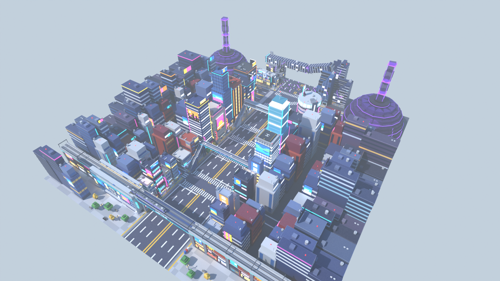

# Zone 5 « ville de nuit » — style stud, pour le jeu Roblox « Volez un œuf »

Cinquième zone du couloir, après Dragon Ball et avant Bleach : une grande ville japonaise de nuit pendant
un incident surnaturel, lisible sous le ciel bleu du jeu. Néons, écrans géants, carrefour « scramble »,
puis un quartier en ruine sous des dômes de barrière violets. **Couloir de course vide au centre** (90 studs),
décor tout autour. Le modèle exporté s'appelle `ZoneVilleNuit` (nom neutre, sans nom de licence).



| Vue | Fichier |
|---|---|
| Entrée, vue joueur (viaduc ferroviaire et son train) | [`rendus/entree.png`](rendus/entree.png) |
| Rue commerçante | [`rendus/rue.png`](rendus/rue.png) |
| Quartier des tours et des écrans | [`rendus/tours.png`](rendus/tours.png) |
| Approche du carrefour (tour cylindrique, dôme) | [`rendus/approche.png`](rendus/approche.png) |
| Carrefour « scramble » = place des œufs | [`rendus/place.png`](rendus/place.png) |
| L'incident (fissures, gravats, arche effondrée) | [`rendus/incident.png`](rendus/incident.png), [`rendus/final.png`](rendus/final.png) |
| Retour vers la base | [`rendus/retour.png`](rendus/retour.png) |
| Vue de côté / plan de dessus | [`rendus/cote.png`](rendus/cote.png), [`rendus/plan.png`](rendus/plan.png) |

## Ce qu'il y a dans la zone

Dans l'ordre de la course :

1. **Le viaduc ferroviaire** (z = 0) : pont d'acier à 36 studs au-dessus de la chaussée, un train de banlieue
   à quai, une gare aérienne, la plaque 東口 et des piles couvertes de boutiques et d'écrans.
2. **La rue commerçante** (z = -12 à -150) : immeubles étroits à enseignes verticales (ラーメン, カラオケ, 本,
   薬, 寿司, 映画, 喫茶), supérette コンビニ, rideaux métalliques, poteaux électriques et câbles, feux,
   distributeurs, vélos, une petite rue transversale à passages piétons.
3. **Deux passerelles piétonnes** (z = -150 et -300, dessous à 34 studs, 110 de portée).
4. **Le quartier des tours** (z = -156 à -300) : tours de bureaux à grilles de fenêtres, grands magasins
   (百貨店) à écrans géants (soleil couchant, ville la nuit, vagues), lampadaires, arbres, glissières,
   passages piétons peints au sol tous les ~50 studs.
5. **Le carrefour « scramble »** (centre z = -390) : passages piétons dans quatre directions et en X, la
   **tour cylindrique** à couronne lumineuse, un immeuble couvert d'écrans à chaque bout de la rue
   transversale, la gare à façade vitrée (駅, 西口, 出口) et la première tour de verre endommagée.
   C'est la **place des œufs** (cercle de rayon 34).
6. **L'incident** (z = -436 à -496) : asphalte fissuré avec des lueurs violettes, gravats, voitures
   abandonnées, barrières 立入禁止, tours de verre brisées ; deux **dômes de barrière** violets d'où montent
   des colonnes de voile jusqu'à 150 studs, visibles au-dessus des toits.
7. **La sortie** (z = -496) : le haut d'une tour s'est effondré en **arche brisée** au-dessus du couloir
   (dessous à 42 studs au moins), dalles et fers qui pendent, lueur violette dans la cassure. Passage libre
   de 96 studs au sol.

Des tours d'arrière-plan (|x| ≥ 151) ferment les deux côtés.

## Dimensions (studs)

| Élément | Valeur | Réglage dans `zone.py` |
|---|---|---|
| Couloir de course (vide) | **90 de large**, x ∈ [-45, 45] | `DEMI_COULOIR` |
| Rien au-dessus du couloir | |x| < 46 libre jusqu'à y = 30 ; ouvrages à 34 ou plus | `X_LIBRE_HAUT`, `H_LIBRE` |
| Trottoirs / façades | jusqu'à |x| = 55 | `X_FACADE` |
| Entrée → sortie | **496** | `Z_SORTIE` |
| Place des œufs | cercle de rayon 34, centre en z = -390 | `Z_PLACE`, `R_PLACE` |
| Passage de sortie (au sol) | 96 de large, arche à 42 et plus | `immeuble_effondre(...)` |
| Largeur totale du sol | 526 (x ∈ [-263, 263]) | `X_FOND` |
| Nombre de pièces | **11 000** (budget 13 500) | `zone.py --stats` |

L'origine du modèle est au **centre de l'entrée** (sol sous le viaduc). Les joueurs arrivent de +Z et
courent vers **-Z**. Le parvis devant le viaduc (z de 8 à 56, groupes `Sol/Approche` et `Parvis`) peut être
supprimé si la zone précédente touche directement le viaduc.

## Importer dans Roblox Studio

**Tester tout de suite :** ouvrir `export/ZoneVilleNuit-demo.rbxl` (File › Open from File), puis Play.

**Dans votre jeu :**
1. Explorer › clic droit sur `Workspace` › **Insert from File…** › `export/ZoneVilleNuit.rbxm`
   (ou glisser le fichier dans la fenêtre de Studio).
2. Placer la zone au bout de la zone Dragon Ball, dans la barre de commande :
   `workspace.ZoneVilleNuit:PivotTo(CFrame.new(X, Y, Z))` avec (X, Y, Z) le centre de l'entrée.
3. Les **repères** invisibles du dossier `ZoneVilleNuit.Reperes` servent au jeu : `ZoneOeufs` (place des
   œufs), `Entree`, `Sortie`, `Couloir`.

Studs : intégrés à Roblox (matériau Plastic + `SurfaceType.Studs`) sur les sols, toits et plateformes,
aucune image à importer. Texture HD optionnelle :
`require(workspace.ZoneVilleNuit.Outils.AppliquerStuds)("rbxassetid://VOTRE_ID")`.

## Fichiers

| Fichier | Rôle |
|---|---|
| `zone.py` | Plan de la zone : sol peint (passages piétons, fissures), tours d'arrière-plan, placement des assets, colonnes de voile, contrôles |
| `assets/ouvrages.py` | Viaduc ferroviaire et gare aérienne, train de banlieue, passerelles piétonnes |
| `assets/batiments.py` | Immeubles à boutiques, supérette, tours de bureaux, grands magasins, immeubles de fond, écrans |
| `assets/carrefour.py` | Tour cylindrique, immeuble à écrans, façade de gare |
| `assets/incident.py` | Immeuble effondré en arche, dômes de barrière, tours endommagées, gravats, voitures |
| `assets/mobilier.py` | Poteaux et câbles, feux, lampadaires, distributeurs, vélos, barrières 立入禁止, cônes… |
| `kit.py`, `palette.py`, `textures.py` | Kit en Parts Roblox, palette, texture stud et textes en pixels |
| `blender_scene.py`, `rendu.py`, `apercu.py` | Scène Blender, rendus, export `.blend`/`.glb`, aperçu d'un asset |
| `roblox_export.luau` | Conversion en fichiers Roblox avec [Lune](https://github.com/lune-org/lune) |
| `CONVENTIONS.md`, `CONCEPTION.md` | Règles de construction des assets, plan de conception |

## Régénérer

```bash
cd roblox/zone-jujutsu-kaisen
python3.13 -m venv .venv && .venv/bin/pip install bpy==5.2.3 numpy pillow
.venv/bin/python zone.py --stats                       # plan seul : pièces, couloir libre, chevauchements
.venv/bin/python rendu.py --rapide --sans-export --vues approche,final   # contrôle rapide
.venv/bin/python rendu.py --res 1600x900 --echantillons 16             # rendus + export (.blend, .glb, .rbxm, .rbxl)
.venv/bin/python apercu.py assets.incident:immeuble_effondre --variant 0   # aperçu d'un asset
```

`zone.py --stats` doit afficher `en_attente: []`, `nb_couloir_encombre: 0`, `nb_trop_bas: 0` et
0 chevauchement entre assets posés.

## Propriété intellectuelle

Uniquement des éléments urbains génériques : ville japonaise de nuit, néons, écrans aux images abstraites,
carrefour, gare, catastrophe générique et dômes violets sans motif. Aucun nom de licence ni de personnage
(ni dans le modèle, ni dans les fichiers exportés), aucun symbole, aucun nom d'école, aucune marque ni
enseigne réelle. Les enseignes n'utilisent que des mots courants (ラーメン, カラオケ, 本, 薬, 寿司, 喫茶, 映画,
コンビニ, 百貨店, 駅, 東口, 西口, 出口, 24H, 立入禁止). Le nom de lieu 渋谷 n'apparaît plus. Seul le nom du
dossier source rappelle la licence : ne pas l'utiliser dans le jeu, le titre, les miniatures ni le nom
affiché de la zone.
