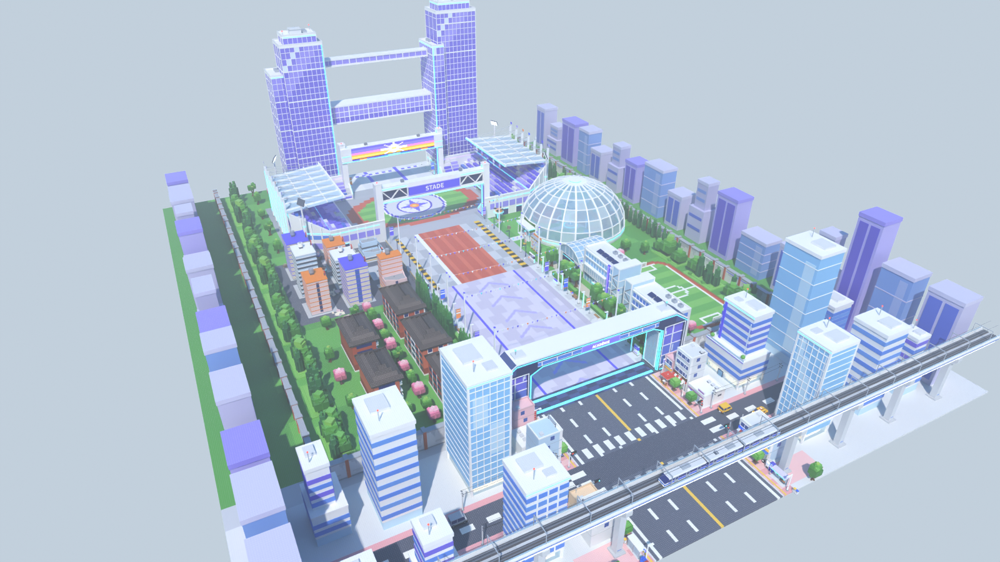

# Zone 8 : l'académie des héros (campus futuriste et sa ville), style stud, pour le jeu Roblox « Volez un œuf »

C'est la dernière zone du couloir. On traverse :
- une rue de ville japonaise moderne ;
- le grand portail de sécurité d'une académie ;
- l'avenue du campus ;
- les terrains d'entraînement ;
- le stade, où se trouve la place des œufs.

On sort sous la passerelle des deux tours de verre. **La route du milieu reste vide sur 90 studs de large**, et tout le décor est autour.



| Vue | Fichier |
|---|---|
| Entrée, vue joueur (rue sous le viaduc) | [`rendus/entree.png`](rendus/entree.png) |
| Rue de la ville et portail de sécurité | [`rendus/ville.png`](rendus/ville.png) |
| Avenue du campus (dans l'axe) | [`rendus/campus.png`](rendus/campus.png) |
| Avenue du campus (côté dortoirs, cadrage de la référence 2) | [`rendus/avenue.png`](rendus/avenue.png) |
| Terrains d'entraînement (dôme, ville factice) | [`rendus/terrains.png`](rendus/terrains.png) |
| Stade et place des œufs | [`rendus/place.png`](rendus/place.png) |
| Tours jumelles (repère final) | [`rendus/tours.png`](rendus/tours.png) |
| Retour vers la base | [`rendus/retour.png`](rendus/retour.png) |
| Vue de côté et plan de dessus | [`rendus/cote.png`](rendus/cote.png), [`rendus/plan.png`](rendus/plan.png) |
| Bonus au crépuscule | [`rendus/campus-crepuscule.png`](rendus/campus-crepuscule.png), [`rendus/place-crepuscule.png`](rendus/place-crepuscule.png), [`rendus/tours-crepuscule.png`](rendus/tours-crepuscule.png) |

## Ce qu'il y a dans la zone

Dans l'ordre de la course :

1. **La rue de la ville** (z de 0 à -124) :
   - un viaduc ferroviaire avec son train, au-dessus de la route, à 36 studs ;
   - des trottoirs roses ;
   - des boutiques à vitrines (CAFÉ, FLEURS, LIVRES, RAMEN…) ;
   - des immeubles de bureaux blancs et bleu ciel ;
   - un carrefour avec des rues latérales et des voitures garées, toujours hors de la route ;
   - des abribus, des distributeurs, des feux et des arbres d'alignement.
2. **Le portail de sécurité** (z = -132) :
   - deux pylônes d'acier bleu nuit et de verre, de 48 studs de haut, avec des bandes lumineuses cyan ;
   - un passage de 100 studs ;
   - une plaque ACADÉMIE côté ville, et trois chevrons lumineux côté campus ;
   - le long mur d'enceinte du campus.
3. **L'avenue du campus** (z de -140 à -296) :
   - au sol, un dallage lavande avec des chevrons qui indiquent le sens de la course, et deux filets violets ;
   - des haies taillées, une rangée de conifères en colonnes et des arbres ronds ;
   - des lampadaires de 16 studs et des bannières colorées ;
   - **six guirlandes de fanions** tendues au-dessus de la route, à 37 studs ; le fanion le plus bas est à 33,6 ;
   - des dortoirs de brique à balcons blancs sur la gauche ;
   - des bâtiments de cours vitrés et une halle d'entraînement sur la droite ;
   - un terrain de sport avec sa piste et sa tribune.
4. **Les terrains d'entraînement** (z de -296 à -400) :
   - une piste d'athlétisme droite de 8 couloirs, au milieu de la route ;
   - à gauche, une **ville factice** : la première rangée est en partie détruite (étages arrachés, pans de façade basculés, brûlures, gravats) ;
   - dans la ville factice, de grands robots d'entraînement de dessin original ;
   - à droite, le **dôme de verre**. On voit au travers une montagne rocheuse ocre, un bâtiment en dôme rouge, des arbres et une fontaine ;
   - à droite aussi, un mur d'escalade, un mât à cibles et une plateforme de drone.
5. **Le stade et la place des œufs** (z de -400 à -528) :
   - des tribunes violettes, lavande et bleues, sous des verrières ;
   - deux portiques à écran géant (soleil couchant et étincelle) ;
   - la route traverse le stade par deux ouvertures de 104 studs ; le dessous des portiques est à 38 studs ;
   - les œufs sont posés au centre de l'arène, sur une **étoile à huit branches** en mosaïque.
6. **Les tours jumelles** (z de -536 à -574) :
   - deux tours de verre bleu-violet à cadres blancs, de **168 et 186 studs** ;
   - elles sont reliées par une **passerelle vitrée de 3 niveaux** au-dessus de la route, dont le dessous est à 72 studs ;
   - une seconde passerelle, plus fine, passe vers 131 studs ;
   - une bande d'arrivée en damier blanc et violet marque la fin de la course.

En arrière-plan, une ville lointaine aux tons brumeux est plus haute le long de la rue et plus basse le long du campus.

## Dimensions (studs)

| Élément | Valeur | Réglage dans `zone.py` |
|---|---|---|
| Route de course (vide) | **90 de large**, x de -45 à 45 | `DEMI_COULOIR` |
| Sol praticable (route et trottoirs) | 110 de large | `X_BORD` |
| Rien au-dessus de la route sous… | 30 studs (\|x\| < 46) | `X_LIBRE`, `Y_LIBRE` |
| Longueur | **574** (entrée en z = 0, sortie en z = -574) | `Z_SORTIE` |
| Début du sol | z = -4 : la zone précédente pose son sol 4 studs après sa sortie | `Z_APPROCHE` |
| Portail de sécurité | passage de 100, en z = -132 | `portail()` |
| Place des œufs | cercle de rayon 34, centre en z = -464 (81 % du parcours) | `Z_PLACE`, `R_PLACE` |
| Stade | de z = -400 à -528, 280 de large | `DEMI_STADE_Z`, `X_STADE` |
| Tours | 168 et 186 de haut, écart de 116, passerelle à 72 | `tours()`, `Y_PASSERELLE` |
| Largeur totale | 478 (sol de x = -239 à 239), murs invisibles aux bords | `X_FOND`, `limites()` |
| Nombre de pièces | **11 137** (plafond : 13 500) | `python3 zone.py --stats` |

L'origine du modèle est au **centre de l'entrée**, au niveau du sol. Les joueurs arrivent par +Z et courent vers **-Z**.

## Importer dans Roblox Studio

**Pour tester tout de suite :** ouvrir `export/ZoneMyHeroAcademia-demo.rbxl` (File › Open from File), puis Play.

**Pour l'ajouter à votre jeu :**
1. Dans l'Explorer, faire un clic droit sur `Workspace` › **Insert from File…** › `export/ZoneMyHeroAcademia.rbxm`. On peut aussi glisser le fichier dans la fenêtre de Studio.
2. Placer la zone au bout de la zone 7 en tapant dans la barre de commande :
   `workspace.ZoneMyHeroAcademia:PivotTo(CFrame.new(X, Y, Z))`, où (X, Y, Z) est la sortie de la zone 7, c'est-à-dire le centre de notre entrée.
3. Les **repères** invisibles du dossier `Reperes` servent au jeu :
   - `ZoneOeufs`, `Entree`, `Sortie` et `Couloir` ;
   - ils ne sont pas solides (CanCollide = false) ;
   - ils restent détectables par `.Touched` et par les raycasts (CanTouch et CanQuery = true).
4. **Bords de la carte :**
   - `Enceinte/Limites` contient deux murs invisibles solides, en |x| = 238,5 ;
   - `Enceinte/LimiteFin` contient une barrière invisible en travers, en z = -578. Elle empêche de tomber au bout de la carte. **À supprimer** si une autre zone suit.

**Studs.** Ils sont intégrés à Roblox (matériau Plastic + `SurfaceType.Studs`) : aucune image à importer. Une texture HD est possible en option :
`require(workspace.ZoneMyHeroAcademia.Outils.AppliquerStuds)("rbxassetid://VOTRE_ID")`.

**Éclairage.**
- Les rendus principaux sont en plein jour, comme dans le jeu.
- Les rendus « crépuscule » montrent la zone au soleil couchant, comme sur les références. Pour obtenir cet effet dans Roblox, un script local peut changer `Lighting.ClockTime` (≈ 17,8) quand le joueur entre dans la zone.
- Blender ignore la réflectance. Dans Studio, le verre des tours brille davantage que sur les rendus.

## Fichiers

| Fichier | Rôle |
|---|---|
| `zone.py` | Plan de la zone : sol peint, placement de tous les assets, murs invisibles, repères, contrôles (`--stats`) |
| `assets/ville.py` | Viaduc et train, boutiques, bureaux, portail de sécurité, mur d'enceinte, ville lointaine |
| `assets/campus.py` | Dortoirs, bâtiments de cours, halle, tours jumelles et passerelles |
| `assets/entrainement.py` | Stade, dôme d'entraînement, ville factice, robots, cibles, mur d'escalade, mât à cibles |
| `assets/vegetation.py` | Conifères, arbres ronds et cerisiers, haies, bosquets, parterres, rochers |
| `assets/mobilier.py` | Lampadaires, bannières, guirlandes de fanions, abribus, voitures, bancs… |
| `kit.py`, `palette.py`, `textures.py` | Kit en Parts Roblox, palette, texture stud et textes |
| `blender_scene.py`, `rendu.py`, `apercu.py` | Scène Blender, rendus de la zone et d'un asset seul, export `.blend` |
| `roblox_export.luau` | Conversion en fichiers Roblox avec [Lune](https://github.com/lune-org/lune) |
| `CONCEPTION.md`, `CONVENTIONS.md` | Plan détaillé de la zone, règles de construction des assets |

## Régénérer

```bash
cd roblox/zone-my-hero-academia
python3.13 -m venv .venv && .venv/bin/pip install bpy==5.2.3 numpy pillow
.venv/bin/python zone.py --stats                               # plan seul, contrôles, pièces par asset
.venv/bin/python rendu.py --res 1600x900 --echantillons 16      # rendus de jour + export (.blend, .rbxm, .rbxl)
.venv/bin/python rendu.py --sans-export --ambiance crepuscule --suffixe=-crepuscule --vues campus,place,tours
```

## Propriété intellectuelle

La zone ne contient que des éléments génériques : un campus moderne, une ville japonaise, un stade, des tours de verre et des robots de dessin original.
- On n'y trouve aucun nom de licence, d'école ou de personnage, aucune lettre ni sigle d'école, aucun emblème ni logo, aucune statue, aucun costume.
- Les panneaux n'utilisent que des mots courants : ACADÉMIE, CAMPUS, ENTRAÎNEMENT, STADE, DORTOIRS, CAFÉ, FLEURS, LIVRES, MARCHÉ, RAMEN, BOULANGERIE, SPORT, PHARMACIE.
- **Attention** : le nom technique du modèle (`ZoneMyHeroAcademia`, `StudsMyHeroAcademia`) contient encore le nom de la licence. Avant publication, mieux vaut renommer le modèle (par exemple `ZoneAcademie`). Il faut aussi éviter ce nom dans le titre, les miniatures et le nom affiché de la zone.
