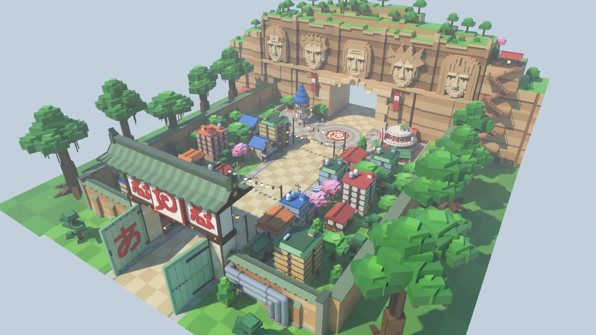

# Zone Naruto (Konoha) — style stud, pour le jeu Roblox « Volez un œuf »

Nouvelle version de la première zone du couloir : le village de Konoha en briques « stud »,
avec un **couloir de course vide au centre** et le décor tout autour.



| Vue | Fichier |
|---|---|
| Entrée, vue joueur (porte あ / ん) | [`rendus/entree.png`](rendus/entree.png) |
| Dans la rue, vers le rocher des Hokage | [`rendus/rue.png`](rendus/rue.png) |
| Place des œufs, résidence du Hokage | [`rendus/place.png`](rendus/place.png) |
| Retour vers la base | [`rendus/retour.png`](rendus/retour.png) |
| Rocher des Hokage | [`rendus/rocher.png`](rendus/rocher.png) |
| Vue de côté / plan de dessus | [`rendus/cote.png`](rendus/cote.png), [`rendus/plan.png`](rendus/plan.png) |

## Ce qu'il y a dans la zone

Dans l'ordre de la course (de la base vers la zone suivante) :

1. **La grande porte de Konoha** : vantaux vert pâle ouverts avec あ et ん, linteau 忍 · spirale · 忍,
   rempart orangé à chaperon de tuiles, gros tuyaux, guérite des gardes.
2. **La rue commerçante** : boutiques, maisons, immeubles à citernes, deux stands de ramen,
   guirlandes de lampions **au-dessus de 30 studs** (la caméra Roblox ne saute pas), poteaux et câbles électriques.
3. **Deux respirations à mi-parcours** : le terrain d'entraînement (trois souches, stèle, cerisier)
   et le jardin du marché (étals, cerisiers, lanternes de pierre).
4. **La place des œufs** : dallage circulaire avec une rosace en spirale, encadré par la **résidence
   ronde du Hokage** (火) et la **tour au toit bleu**, l'arbre à balançoire.
5. **Le rocher des Hokage** : falaise de grès avec cinq visages sculptés stylisés, traversée par un
   passage qui débouche sur la zone suivante.

Autour : une terrasse haute avec un deuxième rang de bâtiments, le rempart du village et une forêt
de grands arbres.

## Dimensions (studs)

| Élément | Valeur | Réglage dans `zone.py` |
|---|---|---|
| Couloir de course (vide) | 60 de large, x ∈ [-30, 30] | `DEMI_COULOIR` |
| Sol praticable (couloir + trottoirs) | 80 de large | `X_FACADE` |
| Porte → façade du rocher | 304 | `Z_ROCHER` |
| Porte → sortie du passage | 364 | `PROF_ROCHER` |
| Place des œufs | cercle de rayon 34, centre en z = -262 | `Z_PLACE`, `R_PLACE` |
| Largeur totale (remparts) | 260, forêt comprise : 420 | `X_REMPART`, `X_FORET` |
| Passage dans le rocher | 68 de large, 48 de haut | appel `rocher_hokage(...)` |

L'origine du modèle est au **centre de l'entrée** (sol de la porte). L'avant de la zone est vers **-Z**.

## Importer dans Roblox Studio

La zone est faite de **vraies Parts Roblox** (blocs, coins, cylindres, boules) : collisions exactes,
pas de limite de triangles, rien à téléverser, et tout reste modifiable dans Studio.

**Option A — tester tout de suite :** ouvrir `export/ZoneNaruto-demo.rbxl` (File › Open from File).
La place contient la zone, l'éclairage des rendus et un point d'apparition devant la porte.

**Option B — dans votre jeu :**
1. Explorer › clic droit sur `Workspace` › **Insert from File…** › `export/ZoneNaruto.rbxm`.
2. Placer la zone : dans la barre de commande,
   `workspace.ZoneNaruto:PivotTo(CFrame.new(X, Y, Z) * CFrame.Angles(0, math.rad(R), 0))`
   avec (X, Y, Z) le centre de l'entrée de la zone dans votre carte.
3. Les **repères** invisibles du dossier `ZoneNaruto.Reperes` servent au jeu : `ZoneOeufs`
   (où poser les œufs), `Entree`, `Sortie`, `Couloir`.

**Studs.** Les faces concernées utilisent les studs intégrés de Roblox (matériau *Plastic* +
`SurfaceType.Studs`) : aucune image à importer, la couleur suit celle de la pièce.
Pour des studs plus nets (texture HD), importer `textures/stud.png` (Asset Manager), puis dans la barre de commande :

```lua
require(workspace.ZoneNaruto.Outils.AppliquerStuds)("rbxassetid://VOTRE_ID")
-- studs deux fois plus gros : require(...)("rbxassetid://VOTRE_ID", { tuile = 2 })
-- revenir aux studs intégrés : require(...)(nil)
```

**Éclairage conseillé** (celui de la place de démo) : `Lighting.LightingStyle = Realistic`,
`PrioritizeLightingQuality = true`, `ClockTime = 14.2`, `Brightness = 2.6`, `Atmosphere` (Density 0.27,
Haze 0.9), `ColorCorrection` (Saturation +0.12, Contrast +0.06), `Bloom` léger.

**Performance.** Ancrage partout, petits détails sans collision ni ombre, grands ensembles découpés en
blocs de 64 studs pour le streaming (`Workspace.StreamingEnabled`, `ModelStreamingBehavior = Improved`).

## Fichiers

| Fichier | Rôle |
|---|---|
| `zone.py` | Plan de la zone : sol, terrasses, remparts, placement de tous les assets |
| `assets/*.py` | Assets paramétrés : `porte`, `rocher`, `residence`, `maisons`, `nature`, `mobilier` |
| `kit.py`, `palette.py` | Kit de construction en Parts Roblox, palette de couleurs |
| `textures.py` | Texture stud, caractères japonais pixelisés (あ, ん, 忍, 火), panneaux |
| `blender_scene.py`, `rendu.py` | Scène Blender, rendus, export `.blend` et `.glb` |
| `roblox_export.luau` | Conversion en fichiers Roblox avec [Lune](https://github.com/lune-org/lune) |
| `apercu.py` | Aperçu d'un asset isolé |
| `CONVENTIONS.md` | Règles de construction des assets |
| `export/` | `ZoneNaruto.rbxm` / `.rbxmx` (modèle), `ZoneNaruto-demo.rbxl` (place), `ZoneNaruto.blend`, `ZoneNaruto.glb` |

## Régénérer

```bash
cd roblox/zone-naruto
python3.13 -m venv .venv && .venv/bin/pip install bpy==5.2.3 numpy pillow   # Blender 5.2 en module Python
.venv/bin/python rendu.py               # plan → rendus/*.png → export/ (.blend, .glb, puis .rbxm/.rbxl via Lune)
.venv/bin/python rendu.py --rapide --vues entree    # contrôle rapide
python3 zone.py --stats                 # plan seul, nombre de pièces par groupe
lune run roblox_export.luau -- build/parts.json export   # export Roblox seul
```

Le fichier `export/ZoneNaruto.blend` s'ouvre dans Blender 4.2 ou plus récent. Avec le MCP Blender,
on peut aussi exécuter `rendu.py` dans la session Blender ouverte.

## Remarque sur la propriété intellectuelle

Roblox retire les jeux qui utilisent une licence sans autorisation (exemple : Shinobi Life 2 en 2020).
Les éléments les plus reconnaissables sont la spirale de la feuille sur la porte, les visages du rocher
et la combinaison « tour rouge + 火 ». Ils sont isolés dans leurs fonctions et faciles à remplacer.
Aucune marque n'est écrite (pas de « Naruto », « Konoha », « Ichiraku » sur les panneaux).
