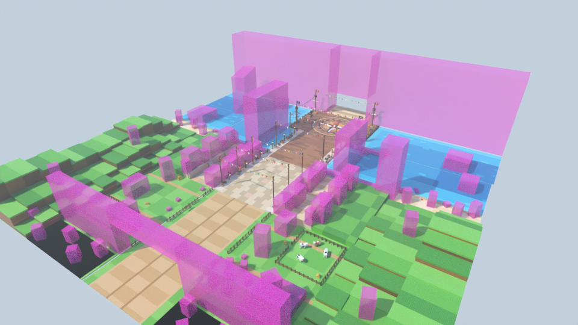

# Zone One Piece (mer de l'Est : port pirate et rocher du crâne) — style stud, pour le jeu Roblox « Volez un œuf »

Deuxième zone du couloir, entre Naruto et Demon Slayer : une petite île ensoleillée de la mer de l'Est.
On passe l'arche du port, on longe la campagne aux moulins, on traverse le bourg coloré, on court sur les quais
entre les navires pirates, on attrape l'œuf sur le grand ponton à rose des vents, puis on sort par la bouche
d'un rocher en forme de tête de mort. **Couloir de course vide de 90 studs au centre**, décor tout autour.



| Vue | Fichier |
|---|---|
| Entrée, vue joueur (arche « ZONE RARE / VITESSE CONSEILLÉE : 200 ») | [`rendus/entree.png`](rendus/entree.png) |
| Campagne aux moulins | [`rendus/campagne.png`](rendus/campagne.png) |
| Rue du bourg | [`rendus/bourg.png`](rendus/bourg.png) |
| Port pirate, à hauteur de joueur | [`rendus/port.png`](rendus/port.png) |
| Galion à quai | [`rendus/quai.png`](rendus/quai.png) |
| Place des œufs (rose des vents) | [`rendus/place.png`](rendus/place.png) |
| Rocher du crâne, sortie par la bouche | [`rendus/crane.png`](rendus/crane.png) |
| Retour vers la base | [`rendus/retour.png`](rendus/retour.png) |
| Vue de côté / plan de dessus | [`rendus/cote.png`](rendus/cote.png), [`rendus/plan.png`](rendus/plan.png) |

## Ce qu'il y a dans la zone

Dans l'ordre de la course (de la base vers la zone suivante) :

1. **Les abords** (40 studs devant l'arche) : palmiers, rochers, buissons, panneau « BIENVENUE ».
2. **L'arche du port** : deux piles de trois mâts liés de cordages sur socle de pierre, nids-de-pie et pavillons
   à tête de mort générique, vergue à voile ferlée et barre de navire. Le **panneau de jeu** bleu marine est
   suspendu au-dessus du couloir : « ZONE RARE » en violet et « VITESSE CONSEILLÉE : 200 » en jaune, sur deux
   planches de 9 et 7,5 studs de haut (lettres d'environ 5 à 6 studs), lisible des deux côtés. Autour : bouées,
   rames croisées, lanternes, filet de pêche à flotteurs, tonneaux, caisses, ancre, et une palissade de pieux avec
   tours de guet jusqu'aux collines.
3. **La campagne aux moulins** : chemin de terre à ornières bordé de clôtures, de buissons fleuris et de palmiers.
   - À gauche : le grand moulin de bois à **ailes jaunes** (44 de haut) tourné vers les joueurs, un champ de blé
     et de choux avec épouvantail, une tour de pierre à dôme, une grange rouge à silo et un enclos à vaches.
   - À droite : un verger de mandarines, une butte et son moulin à calotte bleue, un moulin à **tour rose**,
     une petite grange et un second enclos.
   - Sur les collines en gradins : fermes à toit rouge, vaches, clôtures, mandariniers, palmiers et moulins.
4. **Le bourg du port** : maisons colorées de 2 à 4 étages (murs blancs, bleus, jaunes, roses, rouges ; toits
   rouges, bleus, turquoise ; auvents rayés), une taverne, des étals de fruits et de viande sur l'os, une viande à
   la broche. Derrière, une seconde rangée de maisons sur une terrasse haute, avec escaliers et palmiers.
   - Au sol : grandes dalles ocre et un chemin clair dans l'axe du crâne.
   - Sur les trottoirs : parasols de marché rayés, jardinières, lanternes, tonneaux, bancs.
   - Au-dessus : trois guirlandes de fanions, à 37, 42 et 37 studs.
5. **Le port pirate** : des bassins turquoise de chaque côté du couloir (jamais dedans).
   - À gauche : le grand **galion** à quai (coque brun-rouge, trois mâts, voiles crème) et sa passerelle.
   - À droite : la **caravelle jaune** à quai, et le **phare rouge et blanc** (64 de haut) au bout d'une jetée.
   - Au mouillage : un galion aux voiles rouges et une caravelle turquoise.
   - Sur l'eau : pontons, barques, étal de poissons, îlots à palmiers, plages avec crabes et coquillages.
   - Sur les quais (planches et bordure de pierre claire) : bittes, canons, tonneaux, filets, lanternes, deux guirlandes.
6. **La place des œufs** : un grand ponton (144 de large) avec une **rose des vents** en mosaïque (cercle de rayon
   34, nord rouge vers la sortie). Autour : quatre mâts de vigie à pavillons, des guirlandes, des coffres au trésor,
   des canons, une ancre, une barre de navire, le panneau « TRÉSOR », et des pieux et cordages au bord de l'eau.
7. **Le rocher du crâne** : une tête de mort **générique** de 130 de haut, avec orbites et nez sombres et de longues
   dents pointues sur fond sombre.
   - Le couloir traverse **la bouche** (96 de large, pointes des dents à 36 studs et plus) jusqu'à la zone suivante.
   - Dans la bouche : lanternes, stalactites, une niche au trésor.
   - De part et d'autre : falaises de grès chaud à lianes, une épave échouée à gauche, une cascade à droite.
   - Au sommet : palmiers et un pavillon.

## Dimensions (studs)

| Élément | Valeur | Réglage dans `zone.py` |
|---|---|---|
| Couloir de course (vide) | **90 de large**, x ∈ [-45, 45] | `DEMI_COULOIR` |
| Sol praticable (couloir + trottoirs et quais) | 110 de large, façades en \|x\| = 55 | `X_BORD` |
| Arche d'entrée | ouverture 110, panneau à 35 studs et plus au-dessus du sol | appel `porte_entree(ouverture=…)` |
| Arche → sortie par la bouche du crâne | **400** (Naruto : 364) | `Z_SORTIE` = `Z_ROCHER` - `PROF_ROCHER` |
| Campagne, bourg, port | z de 0 à -112, de -112 à -204, de -204 à -292 | `Z_BOURG`, `Z_PORT`, `Z_PONTON` |
| Place des œufs | cercle de rayon 34, centre en z = -328, ponton de 144 de large | `Z_PLACE`, `R_PLACE`, `X_PLACE` |
| Rocher du crâne | façade en z = -366, 130 de haut, 440 de large, 34 d'épaisseur | `Z_ROCHER`, `H_ROCHER`, `PROF_ROCHER` |
| Bouche du crâne | 96 de large, dents à 36 studs et plus | `PASSAGE` |
| Largeur totale | 440 (\|x\| ≤ 220), murs invisibles sur les bords | `X_FOND` |
| Abords (devant l'arche) | 40 (z de 0 à +40), groupe `Abords` | `Z_APPROCHE` |
| Eau | surface à y = -1,5 (sol et quais à y = 0) | `Y_EAU` |

L'origine du modèle est au **centre de l'entrée** (au sol, sous l'arche). L'avant de la zone est vers **-Z**.
Rien de solide dans le couloir au sol, rien du tout au-dessus du couloir sous 30 studs (la caméra Roblox ne
saute pas) : les fanions les plus bas sont à 31 studs, le panneau de l'arche à 35, les dents du crâne à 36.
Rien ne dépasse z = -400 : la zone suivante commence exactement là.

**Pièces : 12 219** (budget 12 500), dont 30 portent un panneau de texte (SurfaceGui). `python zone.py --stats`
donne le détail par groupe.

## Importer dans Roblox Studio

La zone est faite de **vraies Parts Roblox** (blocs, coins, cylindres, boules) : collisions exactes,
pas de limite de triangles, rien à téléverser, et tout reste modifiable dans Studio.

**Tester tout de suite :** ouvrir `export/ZoneOnePiece-demo.rbxl` (File › Open from File), puis Play.
La place contient la zone, l'éclairage des rendus et un point d'apparition devant l'arche.

**Dans votre jeu :**
1. Explorer › clic droit sur `Workspace` › **Insert from File…** › `export/ZoneOnePiece.rbxm`
   (ou glisser le fichier dans la fenêtre de Studio).
2. Placer la zone au bout de la zone Naruto, dans la barre de commande :
   `workspace.ZoneOnePiece:PivotTo(CFrame.new(X, Y, Z))`, avec (X, Y, Z) le point où l'entrée doit se trouver
   (centre du couloir, au sol). Le **pivot du modèle est le centre de l'entrée** : il est enregistré dans le fichier.
   Si votre couloir ne file pas vers -Z, ajoutez une rotation de R degrés :
   `workspace.ZoneOnePiece:PivotTo(CFrame.new(X, Y, Z) * CFrame.Angles(0, math.rad(R), 0))`.
3. Le groupe **`ZoneOnePiece.Abords`** contient les 40 studs d'approche devant l'arche : sol, palmiers, panneau
   « BIENVENUE » et début des collines. Supprimez-le si la zone est collée à la sortie de la zone précédente, sinon
   il tomberait dedans. Les accessoires au pied de l'arche dépassent de 11 studs vers +Z.
4. Les **repères** invisibles du dossier `ZoneOnePiece.Reperes` servent au jeu :
   - `ZoneOeufs` : le carré de 68 × 68 autour de la rose des vents, où poser les œufs ;
   - `Entree` et `Sortie` ;
   - `Couloir` : toute la longueur du couloir.
5. Le nom `ZoneOnePiece` est interne. Si le nom du modèle est affiché aux joueurs, renommez-le, par exemple en
   `ZonePort`. Adaptez alors le chemin des commandes ci-dessous.

**Studs.** Les faces concernées utilisent les studs intégrés de Roblox (matériau *Plastic* +
`SurfaceType.Studs`) : aucune image à importer, la couleur suit celle de la pièce. Pour des studs plus nets
(texture HD), importez `textures/stud.png` (Asset Manager), puis lancez dans la barre de commande :

```lua
require(workspace.ZoneOnePiece.Outils.AppliquerStuds)("rbxassetid://VOTRE_ID")
-- studs deux fois plus gros : require(...)("rbxassetid://VOTRE_ID", { tuile = 2 })
-- revenir aux studs intégrés : require(...)(nil)
```

**Éclairage conseillé** (celui de la place de démo) :
- `Lighting.LightingStyle = Realistic`, `PrioritizeLightingQuality = true` ;
- `ClockTime = 14.2`, `Brightness = 2.6` ;
- `Atmosphere` (Density 0.27, Haze 0.9), `ColorCorrection` (Saturation +0.12, Contrast +0.06) et un `Bloom` léger.

**Performance.**
- Tout est ancré.
- Les petits détails n'ont ni collision ni ombre portée : cordages, fanions, cadres de fenêtres, lisses…
- Les grands ensembles (sol, eau, collines, arche, rocher) sont découpés en blocs de 64 × 64 studs pour le
  streaming (`Workspace.StreamingEnabled`, `ModelStreamingBehavior = Improved`).
- L'eau est solide : on peut marcher dessus jusqu'aux deux murs invisibles du groupe `Limites`.

## Fichiers

| Fichier | Rôle |
|---|---|
| `zone.py` | Plan de la zone : sols, eau, collines, placements, contrôles (couloir libre, rien de trop bas au-dessus, chevauchements) |
| `assets/monuments.py` | Arche du port, rocher du crâne (bouche, falaises, épave, cascade) |
| `assets/port.py` | Galion, caravelle, barques, phare, pontons et jetée |
| `assets/batiments.py` | Maisons du port, taverne, étals, granges |
| `assets/nature.py` | Moulins (bois, tour rose, pierre à dôme, calotte bleue), palmiers, mandariniers, buissons, rochers, îlots, butte |
| `assets/mobilier.py` | Clôtures, vaches, tonneaux, caisses, canons, ancres, coffres, fanions, lanternes, parasols, panneaux… |
| `kit.py`, `palette.py`, `textures.py` | Kit en Parts Roblox, palette, texture stud et textes |
| `blender_scene.py`, `rendu.py` | Scène Blender, rendus, export `.blend` et `.glb` |
| `roblox_export.luau` | Conversion en fichiers Roblox avec [Lune](https://github.com/lune-org/lune) |
| `apercu.py` | Aperçu d'un asset isolé |
| `CONCEPTION.md`, `CONVENTIONS.md` | Plan détaillé de la zone, règles de construction des assets |
| `export/` | `ZoneOnePiece.rbxm` (modèle), `ZoneOnePiece-demo.rbxl` (place de démo), `ZoneOnePiece.blend` ; `.rbxmx` et `.glb` sont régénérés en local (non suivis par git) |

## Régénérer

```bash
cd roblox/zone-one-piece
python3.13 -m venv .venv && .venv/bin/pip install bpy==5.2.3 numpy pillow   # Blender 5.2 en module Python
.venv/bin/python rendu.py --res 1600x900 --echantillons 16   # rendus/*.png + export/ (.blend, .glb, .rbxm, .rbxl)
.venv/bin/python rendu.py --rapide --sans-export --vues entree,port   # contrôle rapide de quelques vues
.venv/bin/python zone.py --stats            # plan seul : pièces par groupe, couloir libre, rien de trop bas
.venv/bin/python zone.py --chevauchements   # assets posés qui se recoupent
.venv/bin/python apercu.py assets.port:galion --variant 0   # un asset seul → apercus/
lune run roblox_export.luau -- build/parts.json export      # export Roblox seul
```

L'export Roblox demande [Lune](https://github.com/lune-org/lune/releases) 0.10 ou plus récent, dans le `PATH`
ou indiqué par la variable `LUNE`. Il relit les fichiers écrits et vérifie le nombre de pièces et le pivot.

## Propriété intellectuelle

Roblox retire les jeux qui utilisent une licence sans autorisation. La zone s'en tient donc à des éléments
génériques de piraterie et de mer tropicale :
- navires pirates génériques, sans figure de proue reconnaissable ;
- pavillons à tête de mort générique ;
- phare rayé, moulins, rose des vents, coffres au trésor, mandarines, viande sur l'os de dessin animé.

Ce qui en est absent :
- aucun nom de la licence (série, personnages, navires, villes, restaurant, Marine) ;
- aucun emblème d'équipage ni logo ;
- aucun personnage : l'épouvantail porte une blouse bleue et un petit chapeau brun, pas de chapeau de paille.

Les panneaux n'utilisent que des mots français courants : ZONE RARE, VITESSE CONSEILLÉE : 200, BIENVENUE, MOULIN,
FERME, TAVERNE, FRUITS, VIANDE, ÉPICES, POISSONS, PORT, PHARE, TRÉSOR.

Pour le titre du jeu, les miniatures et le nom affiché de la zone, évitez aussi « One Piece » et les noms de la série.
