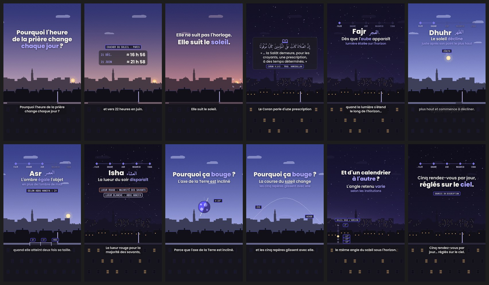

# Vidéo 01 : « Pourquoi l'heure de la prière change chaque jour ? »

> **Statut** : le script et l'animatic sont prêts.
> **À faire avant publication** :
> 1. Enregistrer la voix off.
> 2. Faire relire le texte par une personne compétente.
> 3. Ouvrir une fois les pages sources en ligne (liste au § 7).

| | |
|---|---|
| Durée | ≈ 1 min 26 |
| Format | 9:16, 1080 × 1920, 30 i/s |
| Public | Toute personne curieuse, musulmane ou non. Aucun prérequis. |
| Ton | Calme, curieux, précis. On explique, on ne fait pas la morale. |
| Style | « Nuraq pixel » (voir [`../../direction-artistique.md`](../../direction-artistique.md)) |
| Prototype | [`animatic/animatic.mp4`](animatic/animatic.mp4) · sous-titres [`animatic/sous-titres.srt`](animatic/sous-titres.srt) · storyboard [`images/planche.jpg`](images/planche.jpg) |



---

## 1. Sujet et idée centrale

**Sujet** : les cinq temps de la prière quotidienne et la raison de leurs changements d'horaire.

**Idée centrale** : les heures de prière ne sont pas fixées à l'horloge. Les textes les définissent par des **repères observables dans le ciel** :
- l'aube ;
- le soleil qui passe son point le plus haut ;
- la longueur des ombres ;
- le coucher du soleil ;
- la disparition de la lueur du soir.

La course du soleil change tous les jours, alors les horaires changent aussi.

**Pourquoi ce sujet** :
- C'est une question très courante (« pourquoi Isha est à 23 h l'été ? », « pourquoi deux calendriers ne donnent pas la même heure ? »).
- Il se prête parfaitement au monde pixel : un **cycle jour/nuit façon jeu vidéo** sert de fil conducteur.
- Il permet de montrer de vraies divergences entre savants, sans polémique.

---

## 2. Accroche

**À l'écran** (0:00–0:03) : « Pourquoi l'heure de la prière change **chaque jour** ? »
**Voix** : la même phrase.

Juste après, un **fait vérifiable** sert de preuve :

> « À Paris, le soleil se couche vers 17 heures en décembre… et vers 22 heures en juin. »

Valeurs exactes affichées : 21 déc. ≈ 16 h 56, 21 juin ≈ 21 h 58. Elles ont été calculées, voir § 7.

L'accroche ne promet rien qu'elle ne tient pas : elle pose une question, puis la vidéo y répond.

**Variantes possibles** (même exactitude) :
- « Cinq prières par jour. Aucune n'a d'heure fixe. »
- « En juin, Isha peut tomber près de minuit à Paris. Pourquoi ? » Si on garde celle-ci, il faut afficher un horaire réel tiré d'un calendrier publié et nommer ce calendrier.

---

## 3. Déroulé séquencé

| # | Temps | Séquence | Ce qu'on voit (visuel et mouvement) | Texte à l'écran |
|---|---|---|---|---|
| 0 | 0:00–0:03 | **Accroche** | Ville en pixel art au coucher du soleil : coupole et minaret en silhouette à gauche, parc à droite. Le soleil est bas, à droite. Nuages qui dérivent pixel par pixel. | « Pourquoi l'heure / de la prière change / **chaque jour** ? » |
| 1 | 0:03–0:09 | **Le constat** | Une carte en verre apparaît, avec l'étiquette « COUCHER DU SOLEIL · PARIS ». Les deux lignes arrivent une par une (petit bip). Le soleil continue de descendre. | `21 DÉC.` ≈ 16 h 56 · `21 JUIN` ≈ 21 h 58 |
| 2 | 0:09–0:14 | **La clé** | Quatre crochets de visée clignotent deux fois autour du soleil, puis restent fixes pendant qu'il touche l'horizon. | « Elle ne suit pas l'horloge. » puis « Elle suit le **soleil**. » |
| 3 | 0:14–0:21 | **Le fondement** | La nuit tombe en accéléré, les étoiles et les fenêtres s'allument. Carte en verre : icône de livre, verset en arabe, traduction, référence. La carte disparaît, puis vient une phrase de transition. | Verset 4:103 (voir § 4) · `CORAN 4:103 · TRAD. HAMIDULLAH` · « La Sunna décrit ces temps / avec des repères / dans le **ciel**. » · `D'APRÈS SAHIH MUSLIM 612` |
| 4 | 0:21–0:29 | **Fajr** | La piste à 5 losanges apparaît en haut. À l'est (à gauche, derrière la coupole), une lumière blanche **s'étale à l'horizontale** le long de l'horizon, et le 1er losange s'allume (carillon). Arc pointillé discret : la future course du soleil. | **Fajr** الفجر · « Dès que l'**aube** apparaît » · « lumière étalée sur l'horizon » puis « … jusqu'au lever du soleil » |
| 5 | 0:29–0:34 | **Dhuhr** | Accéléré de 2 s, du lever au zénith, avec un léger souffle. Petit repère « ZÉNITH ». Le soleil dépasse le point haut et le 2e losange s'allume. | **Dhuhr** الظهر · « Le soleil **décline** » · « juste après son point le plus haut » |
| 6 | 0:34–0:45 | **Asr** | Sur la terrasse, un bâton et son ombre, qui s'allonge vers la gauche. Le bout de l'ombre de midi est marqué (« MIDI »). Une copie lavande du bâton **se couche sur le sol** pour mesurer sa taille, repère « 1× ». L'ombre atteint ce repère : 3e losange. Puis une 2e copie donne le repère « 2× ». | **Asr** العصر · « L'ombre **égale** l'objet » · « en plus de l'ombre de midi » · `MIDI` `1×` `2×` · `SELON ABOU HANIFA : 2×` |
| 7 | 0:45–0:48 | **Maghrib** | Le soleil passe sous l'horizon, dans la trouée du parc. Lueur corail, puis 4e losange. | **Maghrib** المغرب · « Dès le **coucher** du soleil » |
| 8 | 0:48–0:57 | **Isha** | La lueur corail (rouge) s'éteint et le 5e losange s'allume. Un voile blanc reste un moment, puis s'éteint à son tour. Deux étiquettes : bordure corail, puis bordure blanche. | **Isha** العشاء · « La lueur du soir **disparaît** » · `LUEUR ROUGE · MAJORITÉ DES SAVANTS` · `LUEUR BLANCHE · ABOU HANIFA` |
| 9 | 0:57–1:08 | **Pourquoi ça bouge** | Fondu pixel vers un ciel de jour. Une petite Terre en pixel, axe incliné, étiquette « ≈ 23° ». Elle disparaît, puis deux arcs pointillés se tracent : **été** (haut et long), puis **hiver** (bas et court). | « Pourquoi ça **bouge** ? » · « L'axe de la Terre est incliné » puis « La course du soleil change » · `ÉTÉ` `HIVER` · « les cinq repères glissent avec elle » |
| 10 | 1:08–1:21 | **D'un calendrier à l'autre** | Fondu pixel vers la nuit d'avant l'aube. Jauge verticale « SOLEIL SOUS L'HORIZON » : un petit soleil remonte et s'arrête à −18°, −15° puis −12°. La lueur de l'aube grandit à chaque arrêt. | « Et d'un calendrier / **à l'autre** ? » · « L'angle retenu **varie** » · « selon les institutions » puis « d'où des écarts, parfois importants » |
| 11 | 1:21–1:26 | **Fin** | Nuit étoilée. Les 5 losanges se rallument en cascade, puis fondu vers `#1D1D1D`. | « Cinq rendez-vous par jour, / réglés sur le **ciel**. » · `SOURCES EN DESCRIPTION` |

Pas de signature Nuraq, pas d'appel à l'action. La dernière image peut servir de couverture en boucle : la nuit, la piste allumée.

---

## 4. Textes à l'écran et sous-titres

### Voix off (≈ 230 mots, débit posé ≈ 160 mots/min)

> **[0:00]** Pourquoi l'heure de la prière change chaque jour ?
> **[0:03]** À Paris, le soleil se couche vers 17 heures en décembre… et vers 22 heures en juin.
> **[0:09]** Parce que la prière ne suit pas l'horloge. Elle suit le soleil.
> **[0:14]** Le Coran parle d'une prescription « à des temps déterminés ».
> **[0:17]** Et ces temps, la Sunna les décrit avec des repères dans le ciel.
> **[0:21]** Fajr : dès que l'aube apparaît, quand la lumière s'étend le long de l'horizon… et jusqu'au lever du soleil.
> **[0:29]** Dhuhr : quand le soleil a passé son point le plus haut et commence à décliner.
> **[0:34]** Asr : quand l'ombre d'un objet devient égale à sa taille, en plus de son ombre de midi. Selon l'imam Abou Hanifa : quand elle atteint deux fois sa taille.
> **[0:45]** Maghrib : dès que le soleil s'est couché.
> **[0:48]** Isha : quand la lueur du crépuscule a disparu. La lueur rouge pour la majorité des savants, la lueur blanche selon Abou Hanifa.
> **[0:57]** Mais pourquoi ces heures bougent-elles chaque jour ? Parce que l'axe de la Terre est incliné. Au fil de l'année, la course du soleil change… et les cinq repères glissent avec elle.
> **[1:08]** Aujourd'hui, ces moments sont calculés à l'avance. Mais pour l'aube et la nuit, tous les calendriers ne retiennent pas le même angle du soleil sous l'horizon. D'où des écarts, parfois importants.
> **[1:21]** Cinq rendez-vous par jour… réglés sur le ciel.

**Prononciation** :
- Fajr : *fadjr*
- Dhuhr : *dhohr* (dh comme le *th* anglais de *this*)
- Asr : *'asr*
- Maghrib : *maghrib* (gh grasseyé)
- Isha : *'icha*
- Abou Hanifa : *a-bou ha-ni-fa*
- Salât : *sa-lât*

### Citation coranique (séquence 3)

- **Arabe** (texte Tanzil, écriture simple) : إِنَّ الصَّلَاةَ كَانَتْ عَلَى الْمُؤْمِنِينَ كِتَابًا مَّوْقُوتًا
- **Français** : « … la Salât demeure, pour les croyants, une prescription, à des temps déterminés. »
- **Référence affichée** : `CORAN 4:103 · TRAD. HAMIDULLAH`. L'édition est précisée dans la description, voir § 7.

Les points de suspension remplacent le mot « car », qui ouvre la proposition dans la traduction. Le reste est mot pour mot.

### Sous-titres

- Fichier prêt à importer : [`animatic/sous-titres.srt`](animatic/sous-titres.srt), 31 sous-titres découpés aux ponctuations.
- Règles :
  - 52 caractères maximum, sur 2 lignes au plus ;
  - Poppins SemiBold 44 px, blanc cassé, sur une pastille `#14131A` à 80 % ;
  - centrés vers y = 1480, au-dessus de la légende TikTok.
- **Recalage obligatoire** après l'enregistrement de la vraie voix : les durées actuelles sont estimées.
- Si l'on active les sous-titres automatiques de TikTok, il faut retirer ceux de la vidéo pour éviter le doublon.

---

## 5. Indications visuelles, transitions et mouvements

**Fil conducteur** : un seul décor, une ville en pixel art vue depuis une terrasse, dont le **ciel sert d'horloge**. La vidéo suit une journée complète : coucher, nuit, aube, midi, après-midi, coucher, nuit. Cela remplace les nombreux plans de la référence et donne une impression de « jeu ».

- **Pixel art** :
  - grille 216 × 384, agrandie ×5 au plus proche voisin ;
  - dégradés tramés (Bayer 4×4) ;
  - aucun zoom ni rotation sur le pixel art ;
  - les nuages avancent d'un pixel à la fois, les étoiles scintillent très doucement, les fenêtres s'allument à la tombée de la nuit.
- **Couleurs** :
  - ciel violet-bleu, même de jour ;
  - nuit presque noire ;
  - lueur corail seulement au coucher et au crépuscule rouge, lumière blanche à l'aube et au crépuscule blanc ;
  - le violet `#6157F8` reste réservé à la piste, aux étiquettes et aux accents.
- **Texte** : fondu de 0,35 s avec une montée de 10 px, puis immobile ; sortie en fondu de 0,3 s. Les mots-clés sont en lavande, un par ligne au maximum. Pas de machine à écrire sur le verset.
- **Transitions** : coupes « invisibles » (le ciel change en continu) et trois **fondus pixel** de 0,5 s (trame de Bayer), vers le schéma des saisons, la jauge et la fin.
- **Piste de progression** : 5 losanges, chacun allumé au moment exact du repère (aube, zénith passé, ombre 1×, coucher, lueur rouge éteinte). C'est une métaphore légère des parcours Nuraq, sans interface.
- **Schémas assumés comme simplifiés** :
  - journée symétrique de 6 h à 18 h ;
  - ombre vue de profil ;
  - jauge d'angles non proportionnelle.

  Les seules valeurs chiffrées à l'écran (horaires de Paris, 23°, 12° / 15° / 18°) sont réelles. Ajouter « schémas simplifiés » dans la description.
- **Zones de sécurité** : textes entre y = 270 et 700, sous-titres vers 1480, rien d'essentiel à droite de x = 940.
- **Respect** : aucun personnage. La mosquée n'apparaît qu'en silhouette d'architecture, sans croissant décoratif. Le verset n'apparaît que dans la carte, avec sa référence, et jamais comme texture.

---

## 6. Besoins : sources, images, son

**Sources** : voir § 7 ; elles sont reprises en entier dans la description.

**Images** : aucune image externe. Tout est généré par [`animatic/render.py`](animatic/render.py), donc 100 % libre de droits. Améliorations possibles :
- remplacer la silhouette de la ville par une illustration pixel plus riche, avec le prompt de la charte (même cadrage, horizon vers y ≈ 1130) ;
- refaire la Terre et la jauge à la main pour plus de finesse.

**Polices** (licence OFL, usage commercial libre) :
- Poppins pour le texte ;
- VT323 pour les étiquettes ;
- Amiri pour l'arabe.

**Son** :
- **Voix off** à enregistrer : une voix posée, chaleureuse, homme ou femme. Micro proche, pièce sèche, silences resserrés (0,15 à 0,3 s) comme dans la référence.
- **Pas de musique.** L'ambiance de l'animatic est synthétisée, donc libre :
  - vent bas ;
  - oiseaux à l'aube et le jour ;
  - grillons la nuit ;
  - petit souffle pendant l'accéléré ;
  - bips d'étiquette et carillons de progression.

  Au mixage, la placer **18 à 24 dB sous la voix**.
- Si l'on préfère des sons réels, prendre des sons d'ambiance CC0 et noter leurs liens.

**Description TikTok proposée** :

> Pourquoi l'heure de la prière change chaque jour ? Parce qu'elle suit le soleil 🌅
> Sources :
> • Coran 4:103 (trad. Hamidullah)
> • Sahih Muslim 612
> • Abou Dawoud 393 / Tirmidhi 149 (hadith de l'imamat de Jibril)
> • Sahih Muslim 1094 (l'aube qui s'étale)
> • Ibn Rushd, Bidayat al-Mujtahid (divergences sur Asr et Isha)
> • Horaires de Paris : calcul astronomique
> Schémas simplifiés. Pour les horaires de ta ville, réfère-toi à ta mosquée locale.

---

## 7. Références à vérifier

Méthode : un agent a cherché chaque point sur le web. Les textes cités viennent de copies publiques des bases Tanzil, QuranEnc et sunnah.com, et de la bibliothèque OpenITI. Les pages officielles n'étaient pas accessibles depuis l'environnement de travail. **Avant publication, ouvrir une fois chaque lien canonique dans un navigateur.**

| # | Affirmation (écran ou voix) | Source | État |
|---|---|---|---|
| 1 | Coucher du soleil à Paris ≈ 16 h 56 (21 déc.) et ≈ 21 h 58 (21 juin) | Calcul astronomique (algorithme NOAA/Meeus, vérifié avec PyEphem), 48,8566° N 2,3522° E, horizon −0,833°, année 2026 : 16:56:04 HNEC et 21:57:50 HAEC | ✅ Calcul refait deux fois. À recouper sur [timeanddate.com/sun/france/paris](https://www.timeanddate.com/sun/france/paris) |
| 2 | « une prescription, à des temps déterminés » | **Coran 4:103**. Arabe : Tanzil. Français : Hamidullah, version Tanzil `fr.hamidullah` : « … car la Salât demeure, pour les croyants, une prescription, à des temps déterminés. » | ✅ Mot pour mot. ⚠️ La version QuranEnc (Hamidullah corrigée par le centre Rowwad, [quranenc.com](https://quranenc.com/fr/browse/french_hameedullah/4)) dit « la prière (As-Salât) ». Le texte original de 1959 n'a pas été vérifié. **Citer l'édition dans la description**. Autre traduction possible : Rashid Maash, « La prière doit être observée par les croyants à des heures déterminées. » |
| 3 | « La Sunna décrit ces temps avec des repères dans le ciel » : début de Dhuhr au déclin, fin d'Asr quand le soleil jaunit, fin du Maghrib à la disparition du crépuscule, Isha jusqu'au milieu de la nuit, Fajr de l'aube au lever du soleil | **Sahih Muslim 612** ('Abdallah ibn 'Amr). Numérotation Fouad 'Abd al-Bâqî ; [sunnah.com/muslim:612d](https://sunnah.com/muslim:612d) (livre 5, hadith 222). Arabe et anglais vérifiés. | ✅ Contenu vérifié. ⚠️ **Aucune traduction française publiée trouvée** : l'écran dit « D'APRÈS », sans guillemets. Ne pas citer ce hadith entre guillemets en français sans traduction publiée (piste : [hadeethenc.com/fr/browse/hadith/10596](https://hadeethenc.com/fr/browse/hadith/10596), dont le narrateur est à vérifier). |
| 4 | Fajr : la lumière qui « s'étend le long de l'horizon », jusqu'au lever du soleil | **Sahih Muslim 1094c** (Samura ibn Jundub) : la blancheur verticale ne compte pas, mais celle qui s'étale à l'horizontale, oui ([sunnah.com/muslim:1094c](https://sunnah.com/muslim:1094c)). Consensus sur « de l'aube vraie au lever du soleil » : Ibn Rushd, *Bidayat al-Mujtahid* 1/103-104 | ✅ ⚠️ Ne pas s'appuyer sur le mot arabe *mustatîl*, employé dans un sens opposé selon les versions |
| 5 | Dhuhr : quand le soleil a passé son point le plus haut | Muslim 612 (إِذَا زَالَتِ الشَّمْسُ) ; Abou Dawoud 393 | ✅ |
| 6 | Asr : ombre égale à l'objet, en plus de l'ombre de midi (majorité) ; deux fois selon Abou Hanifa | Ibn Taymiyya, *Jâmi' al-Masâ'il* 6/338 (Mâlik, Châfi'î, Ahmad, Abou Yoûsouf, Muhammad : 1× hors ombre du zénith ; Abou Hanifa : 2×) ; *al-Hidâya* 1/81 ; hadith de l'imamat de Jibril : **Abou Dawoud 393** (hasan sahih selon al-Albânî) et **Tirmidhi 149** (Tirmidhi : hasan sahih). Le 1er jour, Asr à 1× ; le 2e jour, Asr à 2× ; « le temps est entre ces deux temps » | ✅ ⚠️ Ne pas citer Ibn Rushd pour l'avis d'Abou Yoûsouf et Muhammad : son texte est ambigu sur ce point |
| 7 | Maghrib : dès le coucher du soleil | Abou Dawoud 393 (Maghrib « quand le jeûneur rompt son jeûne », les deux jours) ; Boukhari 561 (Salama ibn al-Akwa', [sunnah.com/bukhari:561](https://sunnah.com/bukhari:561)) ; Muslim 636 | 🟡 Confirmé par recherche (extraits) ; texte à relire sur sunnah.com. Remarque : certains calendriers ajoutent quelques minutes de précaution |
| 8 | Isha : lueur rouge pour la majorité, lueur blanche selon Abou Hanifa | Ibn Rushd, *Bidayat al-Mujtahid* 1/102 (Mâlik, Châfi'î : rouge ; Abou Hanifa : blanche) ; Ibn Taymiyya, *Jâmi' al-Masâ'il* 6/350 (Ahmad) ; encyclopédie de fiqh Dorar ([dorar.net/feqhia/844](https://dorar.net/feqhia/844)) | ✅ ⚠️ La phrase « الشفق الحمرة » est une parole d'Ibn 'Omar, **pas du Prophète ﷺ** : ne pas la lui attribuer |
| 9 | L'axe de la Terre est incliné, ≈ 23° | Constante astronomique : 23,44° | ✅ |
| 10 | Les calendriers ne retiennent pas tous le même angle (12°, 15°, 18°…) | Conventions répandues (PrayTimes.org) : Ligue islamique mondiale 18° / 17° ; ISNA 15° / 15° ; Égypte 19,5° / 17,5° ; Umm al-Qura 18,5° / Isha 90 min après Maghrib. UOIF / Musulmans de France : 12° / 12° (sources secondaires seulement) | ✅ pour les valeurs à l'écran. ⚠️ **Ne nommer aucune institution française à l'écran.** Pour la Grande Mosquée de Paris, aucune source fiable n'a été trouvée |
| 11 | « des écarts, parfois importants » | Calcul pour Paris le 21 juin : Isha à 12° ≈ 23 h 41, à 17° ≈ 1 h 07. Du 12 au 29 juin, le soleil ne descend jamais à −18° à Paris (minimum −17,7°) | ✅ Calcul (à recouper sur timeanddate.com). Ce fait pourrait nourrir une vidéo suivante |

**Hors écran, pour aller plus loin** : Coran 17:78, « Accomplis la Salât au déclin du soleil jusqu'à l'obscurité de la nuit, et [fais] aussi la Lecture à l'aube, car la Lecture à l'aube a des témoins. » (Hamidullah, version Tanzil).

**Relecture humaine** : faire valider le texte de la voix off et les deux divergences (Asr, Isha) par un enseignant ou un imam. La formulation doit rester neutre : « selon la majorité… / selon Abou Hanifa… », sans hiérarchie entre les avis.

---

## Régénérer l'animatic

```bash
cd animatic
python3 render.py                      # animatic.mp4 + sous-titres.srt (≈ 3 min sur 4 cœurs)
python3 render.py --stills 15.8,42.5   # images de contrôle (dossier stills/)
python3 render.py --no-subs            # version sans sous-titres incrustés
```

Les textes, la voix off (liste `VO`) et le minutage se modifient en haut de la fonction `build_timeline()` et dans `SKY_CLOCK`.
